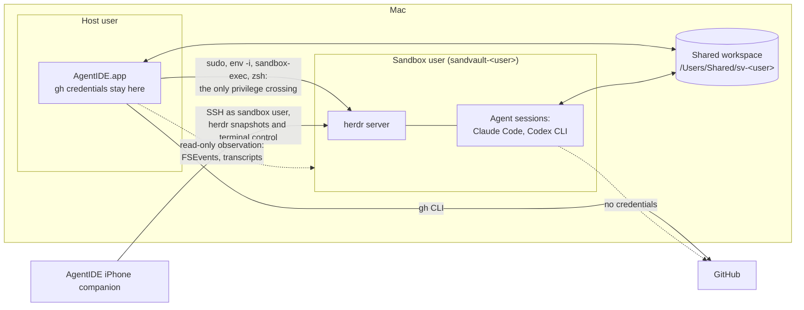
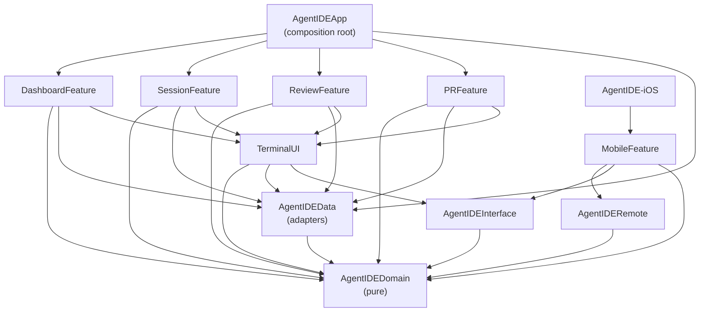

# AgentIDE Architecture

How AgentIDE works under the hood. [README.md](README.md) owns what it
does and why; this document owns the design: what exists, the rules that
keep it working and what is planned. It is written for whoever changes
the code next, human or agent, so each rule says what breaks without it.
Platform quirks (macOS beta, SwiftUI, SwiftFormat, the sandbox toolchain)
live in [AGENTS.md](AGENTS.md); this document does not repeat them.

## Overview

AgentIDE is a native SwiftUI macOS app (macOS 26 or later, Swift 6.4,
AGPL-3.0) that runs, steers and reviews sandboxed AI coding agents in
parallel git worktrees. Its user supervises rather than types, so the
window is arranged around the agent loop, not around an editor.

The architectural thesis, referenced throughout: **AgentIDE holds no
session-critical state**. Agents run as the sandvault sandbox user inside
a [herdr](https://herdr.dev) server that AgentIDE introduces. The app
derives its entire view of the world from herdr, git, agent transcripts
and GitHub, and persists only its own metadata. Killing, crashing or
updating the app loses nothing.

## System context



Boundary facts the design relies on:

- The sandbox may write only to the shared workspace, its own home,
  `/tmp`, `/var/folders` and `/dev`. The host user's home is unreadable
  from inside and keychains are denied.
- The shared workspace is writable by both users through inheriting
  ACLs; it is the data plane for code, prompts and events.
- The sandbox has no GitHub credentials: `gh` is unauthenticated there
  and agent settings deny `git push`. Pushing and everything
  credentialled happens host-side.
- Credentials never cross the boundary in either direction.

## Guiding principles

1. **P1: Derive, don't own.** herdr, git, transcripts and GitHub are the
   sources of truth. The app reconciles from them on every launch.
2. **P2: Unprivileged glue.** The only privilege crossing is the sudoers
   path sandvault already configured. AgentIDE never widens it.
3. **P3: Compiler-enforced boundaries.** Clean architecture mapped onto
   SPM targets; an illegal dependency is a build failure.
4. **P4: Approachable strict concurrency.** MainActor by default in UI
   targets, nonisolated core, `@concurrent` for heavy leaf work,
   structured tasks everywhere.
5. **P5: Agents are pluggable.** One `AgentRunner` seam; agent-specific
   logic lives only in adapters.
6. **P6: One client per external system.** git speaks through
   `GitClient`, GitHub through `gh` in `GitHubClient` and herdr through
   `HerdrClient` locally or `RemoteHerdr` over SSH; both use the shared
   herdr wire types.
7. **P7: Agent output is hostile input.** Every host-side touch of
   guest-writable data is hardened accordingly.

## Process model

Two independent lifecycles: the app process is ephemeral and holds
nothing it cannot rebuild (P1); sessions are herdr workspaces owned by
the sandbox user's herdr server, surviving app restarts, updates and
host logout but not reboot. Reboot recovery is worktree plus transcript
plus resume.

### First-launch setup

After initial setup succeeds, the saved completion marker opens the
dashboard, schedules and terminals immediately on later launches. Local
prerequisites are rechecked once in the background, with independent
checks running concurrently. A failure replaces the workspace with setup
guidance and blocks further actions until repaired. A first-ever launch
shows startup progress in the normal app window until checks succeed.
The workspace then opens; setup controls appear only after a failure.
Completed setups show no startup progress. After a failure, manual
rechecks show a spinner only after half a second. Agent availability
updates in the mounted dashboard when the background check completes.
Missing tools, sandbox access, Git identity, workspace permissions or an
authenticated agent fill the window with a five-step wizard: tools, Git
identity, GitHub, sandvault and agent sign-in. Only the first unfinished
step appears, with copy buttons for each command group, Exit and Recheck
to advance after repair. Homebrew is required; setup links to brew.sh
for its installation and provides Homebrew commands for the other tools.
Setup links always open in the default system browser; embedded browser
routing starts only when the completed setup gives way to the dashboard.
Standalone jq and optional phone or development tools are not required.
The app creates its own directories and installs its hooks in an existing
workspace, without creating accounts, changing sudoers or signing anyone
in.

GitHub authentication and API access are verified until setup first
succeeds, recorded in UserDefaults; later launches need no network for
setup. GitHub's login command selects HTTPS; accepting its default Git
authentication choice configures credentials without a separate command.
Git identity and signing configuration are checked locally, including
files included by the global Git configuration. Only first-time setup
without a saved signing preference can disable the signed-commit
requirement when no signer is available. Later launches preserve saved
choices and otherwise keep signing required, even if the signer probe
fails. Setup never changes global Git configuration, blocks on signing or
attempts a signature. Agent quarantine is cleared through the existing launch
repair before sign-in probes, which run from the sandbox home with its
user's temporary directory and surface diagnostics on failure.
Checks never start herdr or an interactive
agent. Menu actions, Settings and App Intents cannot bypass the gate.
With no restored selection, the first repository reading opens the
repository finder when empty or the new-session form with an editable
repository picker.

### Launching into the sandbox

sandvault's sudoers rules let the host user run exactly `/bin/zsh`,
`/usr/bin/env` and `/usr/bin/true` as the sandbox user without a
password, so every sandbox interaction uses one launch shape, assembled
in exactly one place (`SandvaultLauncher`):

```bash
sudo --non-interactive --login --set-home --user="sandvault-${USER}" \
  /usr/bin/env -i \
  HOME="/Users/sandvault-${USER}" USER="sandvault-${USER}" SHELL=/bin/zsh \
  TERM=xterm-256color COLORTERM=truecolor \
  INITIAL_DIR="${WORKTREE}" SHARED_WORKSPACE="/Users/Shared/sv-${USER}" \
  SV_SESSION_ID="$(uuidgen)" AGENTIDE_SESSION="${SESSION_NAME}" \
  LANG=en_US.UTF-8 \
  PATH=/opt/homebrew/bin:/usr/local/bin:/usr/bin:/bin:/usr/sbin:/sbin \
  GIT_CONFIG_COUNT=1 GIT_CONFIG_KEY_0=safe.directory \
  GIT_CONFIG_VALUE_0="/Users/Shared/sv-${USER}/*" \
  /usr/bin/sandbox-exec -f "/var/sandvault/sandbox-sandvault-${USER}.sb" \
  /bin/zsh -c "${PAYLOAD}"
```

This is byte-compatible with sandvault's own session launch; AgentIDE
substitutes the payload and refuses interactive password prompts.
Payload variables use `${name}` so sudo's login shell leaves their
expansion to the sandbox shell; bare `$name` expands before the payload
runs.
`env -i` gives a clean environment, `GIT_CONFIG_*` injects `safe.directory`
(shared repositories are owned by the other user) and `sandbox-exec`
confines everything downstream, including the herdr server. Claude
launches select an existing native
install through sandvault's `SV_NATIVE_INSTALL` flag; setup probes the
same binaries directly, without invoking installing wrappers. Each
probe checks the first installed binary in sandvault's selection order;
a failed sign-in must not fall through to a different installation.
Before starting herdr, AgentIDE loads sandvault's shell profile, which
adds native and staged agent paths and its launch wrappers.
Every launch passes through one function that refuses a path outside the
shared workspace: the sandbox user can often read a host directory and
must never be given a reason to write to one.

### herdr

herdr is a client-server terminal workspace manager: a background server
owns real terminal panes grouped into workspaces, detects the coding
agent running in each pane and exposes everything over a schema'd,
newline-delimited JSON socket API (`herdr api schema`) the `herdr` CLI
wraps. It is pre-1.0 and admitted as an explicit exception to the
dependency rule below: a runtime tool behind one adapter, never linked,
whose agent-state model replaces machinery the app would otherwise
build.

- There is no daemon or launchd unit. The server starts lazily inside
  the sandbox on first use, through zsh's `&!` with output redirected
  to `~/.config/herdr/agentide-server.log`: this launch context has no
  controlling terminal, so `nohup` refuses to run ("can't detach from
  console"). A server that never answers has that log printed before
  the failure.
- `HERDR_SESSION` names the session, whose socket and state live under
  `~/.config/herdr/sessions/<name>/`, owner-only. The installed app
  uses `agentide`; development builds and tests use `agentide-dev`, and
  tests relocate herdr entirely with `XDG_CONFIG_HOME`, so no build or
  test can list or kill the installed app's sessions.
- Each conversation is one workspace whose single pane runs a login
  shell; the agent command is submitted to that shell (`pane run`)
  behind `export TMPDIR="$(mktemp -d)"`, because a server born through
  sudo resolves no usable temporary directory and Codex's execution host
  dies in its handshake without one. `AGENTIDE_SESSION` and
  `INITIAL_DIR` are workspace environment. A finished agent leaves the
  shell at its prompt with the scrollback inspectable; whether an agent
  runs comes from herdr's detection confirmed by the pane's foreground
  process, never from exit codes. The confirming matters most across a
  reboot, which herdr's own records outlive: a workspace it still says
  holds an agent comes back as a pane sat at its login shell, and
  believing it left the app attaching to that shell instead of
  resuming. A claim this run has not confirmed is checked once against
  the pane's foreground; a pane this run launched is confirmed as it
  starts, so steady state pays nothing and a new agent is never caught
  in the instant before its process registers.
- Workspace labels follow `agentide--<repo>--<branch-slug>--<agent>`
  (`SessionName`): slugs collapse `-` runs so `--` stays unambiguous,
  collisions append `-2`, `.` and `:` are replaced. Labels are a
  readable fallback for herdr's own UI over SSH; the metadata store is
  authoritative. Anything not matching the full shape is foreign and is
  shown only in the session manager, never in the sidebar: a row that
  cannot be entered and steered is noise.
- herdr's official agent integrations are not installed by the app: the
  Codex one flips Codex's hooks feature on, which broke command execution
  in fresh sessions. Hand-installed ones survive; the app neither adds
  nor removes them.
- The app keeps herdr's `[worktrees] directory` pointed at the layout
  below, written once per run only when the config has no such section,
  so `herdr worktree create` lands where the sidebar looks and a hand
  edit wins forever.
- herdr servers outlive the app, so a change to launch commands,
  workspace shapes or server behaviour needs the running session stopped
  (`herdr session stop <name>` as the sandbox user) to take effect.

- A pane listing that could not be read is not a listing of nothing
  (`LastPanes`). Taken as an empty one it emptied every session in the
  app at once: every row lost its agent, every pane read as exited and
  only relaunching brought them back, though herdr had lost nothing
  and the agents were still working. The last answer stands for two
  minutes of failures, after which an empty answer is believed, so a
  herdr that really has gone still shows as gone.

### Terminals

Agent panes attach to herdr as terminal controllers (`herdr terminal
session control <pane> --takeover`, newline-delimited JSON over pipes)
rather than drawing a remote screen over a PTY. herdr streams
`terminal.frame` records of base64 ANSI bytes, opening with a full
repaint, which the pane decodes (`HerdrTerminal` in Domain,
`HerdrTerminalChannel` in DataAccess) into a local SwiftTerm view;
keystrokes go back as `terminal.input`, resizes as `terminal.resize` and
the wheel as `terminal.scroll`. The channel reads its client through
the pipe's readability handler, never a blocking read: every mounted
pane keeps a client, most of them silent, and reads that wait on each
other left a fresh attach blank until some other pane's agent spoke.
Rules that follow from that shape:

- **Visited agent panes stay mounted across sidebar selections.**
  Each keeps its terminal buffer, controller and full pane geometry,
  hiding its native view while inactive. Switching back needs no
  attach or resize round trip: a fresh controller first painted a
  half-height screen before the agent redrew at the window's size.
  Unvisited agents do not attach, and removing a session or worktree
  releases its pane. A real window resize still sizes hidden panes.
- **Frames carry the screen, never the modes.** Cursor moves, colours
  and synchronised updates arrive; the private modes an agent set
  (bracketed paste, kitty keyboard) never do. So the local terminal
  never learns bracketed paste is on, and a paste sent as keystrokes
  submits at every newline. A herdr-backed pane wraps a paste in the
  bracketed-paste markers itself (`HerdrTerminal.pasteBytes`, shared by
  Mac and phone) and removes embedded terminators and escape characters.
  Herdr 0.9.5 recognises that wrapper and sends the paste according to
  the pane's actual mode, including plain text when that mode is off.
  Local shell panes use SwiftTerm's native paste handling instead.
  A paste goes to herdr whole
  (`HerdrLargeInputIntegrationTests` pushes 180 KiB through one
  command); chunking it as separate commands only moved the loss. The
  remaining limit is herdr's: the PTY master accepts a write only while
  the slave's input queue is under `TTYHOG - 2` (1,022 bytes), and
  herdr 0.8.2 takes a short write as a whole one, so a reader that
  stalls while a large paste is in flight loses about a kibibyte from
  the middle (`HerdrSlowReaderIntegrationTests`, disabled until herdr
  waits or retries). Agents drain fast enough that this has not been
  seen in use; pacing the body inside one pair of markers would be the
  in-app mitigation if it is.
- **Option-arrows keep their modifiers in agent panes.** herdr's
  frames omit the keyboard modes too, so an empty local mode does
  not mean the agent wants shell key bindings. Agent panes leave
  those keys to SwiftTerm's modified-arrow encoding; only local
  shells use `TerminalKeys` for traditional word navigation.
- **The numeric keypad types its numbers in shell panes.** zsh asks
  for application keypad mode at every prompt, and SwiftTerm answers
  it as a VT does, sending `ESC O u` for the 5, which a shell has
  nothing bound to. A Mac keyboard has no Num Lock to turn that mode
  off with, so a local shell pane sends the labelled character
  instead (`PaneTerminalView.routeKey`), clearing the selection as
  normal typing does. Enter, Clear, modified presses and any pane
  that turned the kitty keyboard protocol on keep SwiftTerm's encoding.
- **Scrollback lives in herdr.** The pane keeps none
  (`changeScrollback(nil)`), since a scroll answers with a repaint and a
  local history filled with replaced screens showed output three times
  over. Wheel requests carry the pointer's terminal column and row:
  herdr forwards them to agents handling mouse input, or pages its own
  history otherwise. Omitting the position sent every wheel event to
  the top-left cell, outside Codex's conversation. The scroll indicator
  is hidden. Copy All Output reads `pane read --source recent-unwrapped`,
  because a selection can never reach what scrolled past. Known
  limitation: herdr does not rewrap scrollback on resize.
- **`--takeover`** replaces a controller leaked by an earlier app run,
  which would otherwise own the pane's input forever. Full herdr
  clients over SSH attach independently and are never dropped.
  Closing the view releases the controller and never kills the session.
- **Agent panes pin the palette recorded at launch**
  (`terminalSchemes` in the metadata). Agent TUIs read the colours
  once (OSC 10/11) and style their chrome for them forever; re-theming
  on an appearance switch left the composer white on white. Only shell
  panes re-theme live, and only the shell pane on screen answers
  Cmd-K: the shells behind it record the count without acting on it,
  so a clear can never wipe the next shell or worktree shown.
- Copies from an agent pane reflow block by block for prose
  (`PasteableText`): paragraphs lose hard wraps, command-shaped runs
  keep every line. Clipboard cleanup replaces unwritten NUL cells with
  spaces, normalises line endings and removes C0/C1 controls (except
  tabs and line breaks), bidirectional formatting controls, zero-width
  spaces, byte-order marks and trailing row padding before reflow,
  even for single-line selections.
  Zero-width joiners and variation selectors remain intact for Unicode
  text and emoji. Rectangles and Copy All Output use the same cleanup.
  Option-drag copies a rectangle on the character grid; the held block
  also supplies Cmd-C and the Copy menu, without prose reflow.
  Starting a native selection clears both the held block
  and its marquee, so scrolling cannot restore an older copy.
  Processing a herdr frame preserves the selection, including cursor-only
  updates: SwiftTerm preserves unchanged selected text during output
  processing. It still moves or clears the selection when the selected
  text scrolls.

The **host terminal** is a plain login shell on the pane's own PTY as
the host user: no sudo, no sandbox, full `gh` credentials, editor
variables pointing at the app's shim, no server. Shells die with the
app, a deliberate trade after server-backed shells kept wedging their
control clients. A worktree runs as many as the work needs, since a
dev server holds a shell for as long as it runs and the git commands
and API calls beside it need a prompt of their own. `ShellTabs`
(Domain) owns which are open where and which one each worktree is
showing. The plus in the Shell utility bubble, or Shift-Cmd-T, opens
another. Its following close button ends all shells in the selected
worktree. With one shell there is no extra row. With multiple shells,
a full-width bar below the utility tabs divides the width between
them, each tab closing its own shell, and scrolls when their labels
no longer fit. Rules the bar follows:

- **A shell keeps its number for life**, the lowest its worktree was
  not already using, so closing one never renumbers the tab under the
  pointer and a later shell fills the gap instead.
- **Closing the shown shell falls to the tab after it**, the one
  before only when it was the last, so closing along a strip never
  jumps back to its start.
- **Closing a tab explicitly terminates its local process** when
  SwiftUI dismantles the pane, even if the terminal view is still
  retained. It sends SIGHUP before releasing the PTY: interactive zsh
  ignores SwiftTerm's SIGTERM, and releasing the view alone only
  closes its I/O.
- **Only multiple shells reserve room for the tab bar.** Each
  worktree's terminals keep their own top inset, so switching to a
  worktree with a different shell count never resizes hidden shells.
  Adding the second shell or closing back to one resizes only that
  worktree's terminals.

Every running shell and browser page stays mounted whichever tab,
shell or worktree shows, even while the selection is empty.
`RetainedPane` collapses the utility pane without removing its views or
changing their width. Inactive native views are hidden, so they draw
nothing and a page's animation frames stop. The session manager lists
them with a Close, each agent session beside the CLI version it started
with, which after an upgrade is not the installed one until it restarts.

Remote access is SSH to the Mac as the sandbox user, landing on the same
herdr server; `script/attach` covers the host user and the sandbox. No
picker of ours: one `herdr` attach presents every workspace with herdr's
navigation. The login needs only `HERDR_SESSION`, exported by the sandbox
user's shell configuration (synced from the workspace's `user/`
template), since a login from outside inherits none of the sandbox's
environment. Remote Login is enabled for the hidden sandbox user with
`dseditgroup` on `com.apple.access_ssh`.

### Reconciliation

On every launch the app rebuilds state from `herdr api snapshot`
(tolerating "no server running"), `git worktree list` across tracked
repositories, transcript directory scans and finally its own metadata.

Deriving is not trusting one reading: a listing can fail, and
`git worktree list` reports a worktree as detached for the whole of a
rebase. A row the newest reading dropped is kept while its directory
exists; only removal from disk removes the row. The provisional row a
new session draws (a `.pending` path, never a directory) is the one
exception: it is kept until its repository gains a listed row, since
the creation names the branch itself and the two never share a name,
and keeping it any longer sat it beside its own worktree for the whole
of the agent's launch. A placeholder whose launch failed stays until
it is dismissed or retried. This is a display rule,
not a cache. It matters because a row holds its worktree's panes open,
and a pane holds a running shell. The same tolerance applies the other
way round: a mounted pane whose worktree vanished mid-read (a branch
renamed away, cleanup after a merge) reports nothing, since that is
the workspace changing rather than a failure, and the sidebar drops
the row on its own.
If the directory remains but its Git metadata is missing or unreadable,
Review shows that the repository is unavailable instead of repeating
git failures or claiming there are no changes. A failed review read
checks the repository before reporting; ordinary reads add no probe.
Restoring the metadata and refreshing brings the review back.

There is no windowless resident mode: the app quits with its last
window. Sessions keep running; the event spool is durable files, so a
quit app delays notifications rather than losing them. An `SMAppService`
login item is the documented later option.

## Package architecture

One root `Package.swift` defines every library target; the app shell in
`App/` is generated into an Xcode project by XcodeGen (`project.yml`
committed, `.xcodeproj` gitignored). `AgentIDEAppSources` in the package
carries the same sources so `swift build` type-checks them in the
sandbox, where `xcodebuild` cannot run. The companion shell in `iOSApp/`
uses the same project and package, with `AgentIDEiOSAppSources` providing
the equivalent iOS type-check target. Analysis indexes both platforms
so Periphery sees callers behind `#if os(iOS)`.



- **AgentIDEDomain**: entities (`Repository`, `Worktree`,
  `RepositoryGroup`, `AgentSession`, `AgentKind`, `PullRequestSummary`,
  `ReviewThread`, `BranchStack`, `TranscriptSession`, `DiffFile`) and
  pure logic (`DiffParser`, `PatchBuilder`, `SessionName`,
  `HerdrTerminal` frame decoding, `HerdrSnapshot`, the keyword tokenizer, `FuzzyMatcher`,
  `Wrapping`, `ShellTabs`). Foundation value types are allowed;
  process, file, network and database APIs are banned.
- **AgentIDEData**: the adapters, composed by `SessionService`:
  `GitClient`, `GitHubClient` (every question through the host's `gh`),
  `SandvaultLauncher`, `HerdrClient`, `HerdrTerminalChannel`,
  `TranscriptReader` and `CodexTranscriptIndex`, `EventSpool`,
  `MetadataStore` (one JSON file), `PullRequestStore`, `ProcessRunner`
  (Foundation `Process`), `WorkspaceWatcher` (FSEvents),
  `FoundationModelClient` (the on-device model behind one summarisation
  seam) and `AgentRunner` with `ClaudeCodeRunner` and `CodexRunner`.
- **Feature targets** (`DashboardFeature`, `SessionFeature`,
  `ReviewFeature`, `PRFeature`): SwiftUI views and `@Observable`
  MainActor models given the service by injection. `SessionFeature` owns
  the WKWebView browser, transcript log and session manager;
  `ReviewFeature` the diff and editor (SwiftUI text and an attributed
  `NSTextView`).
- **TerminalUI**: shared components, not a feature: the SwiftTerm
  AppKit wrapper, markdown rendering, tooltips and `LinkOpener`,
  `PaneIconButton` (matching icon slots for compact pane controls),
  `HighlightedResultsList` (the arrow-key result
  list every finder and searchable picker shows under its field),
  `SelectableTextView` (read-only document-style selection) and
  syntax highlighting (tree-sitter grammars, with
  the Domain's tokenizer as fallback for fragmentary text).
- **AgentIDEInterface**: shared typography, `BusyButton`, `Motion` and
  `LaunchProgress`; TerminalUI re-exports these for the Mac's features.
- **AgentIDERemote**: SwiftNIO SSH command channels, device Keychain
  credentials, host verification and the remote herdr adapter.
- **MobileFeature**: repository navigation, session creation and a UIKit
  SwiftTerm wrapper. It does not import the macOS data or feature targets.
- **AgentIDEApp**: builds adapters, injects the service, owns navigation,
  Settings and the App Intents. No logic.

Third-party imports are confined (P3): SwiftTerm, Textual, swift-markdown, SwiftSoup,
SwiftTreeSitter and grammars in TerminalUI; WebKit in SessionFeature;
FoundationModels in AgentIDEData; SwiftNIO, SwiftNIO SSH and Swift Crypto
in AgentIDERemote. MobileFeature also uses SwiftTerm’s UIKit renderer.

**One implementation per concern.** Terminals, editors, conversation
views, markdown rendering, git access, GitHub access and link opening
each have exactly one shared component or client. Every in-app link
takes `LinkOpener` (the window's `openURL`): web links to the Browser
tab, or the system browser with Cmd. Commit links in review comments
use the existing `agentide-commit` scheme and open that commit read-only
in Review, scoped to the utility pane’s worktree. Abbreviated hashes
resolve locally without changing HEAD, and returning restores an edited
commit message and its baseline. A request counter allows repeated clicks
on the same commit. Other links without a web scheme and host are refused
with a message rather than handed to the system opener, whose failure is
an unhelpful "error -50". The terminal’s link delegate opens web links
only and leaves a clicked file path selectable.

### The AgentRunner seam

`AgentRunner` (P5) covers exactly: the launch and resume commands for a
prompt file, model, effort and extra arguments; where the agent's
transcripts live (per working directory for Claude Code; one flat date
tree for Codex, which `CodexTranscriptIndex` attributes by the directory
each rollout records, keyed by file name stem because subagent rollouts
share their parent's embedded id); the models and efforts it offers; its
version and model listing command. Agent state (working, idle, done,
blocked) comes from herdr, the same for every agent, so no runner detects
anything. Foreign-session discovery is reconciliation in
`AgentIDEData`, outside the protocol.

Models are asked of every CLI once after first reading and kept in the
metadata under the CLI's version, so `claude models` (a twenty-second
sandbox launch) runs only when the CLI changed. Curated lists serve when
the command fails. The pickers re-validate the agent and model pair on
appearance as well as on change: a persisted Codex model once reached
Claude.

## Concurrency model

| Target | Default isolation | Notes |
|---|---|---|
| AgentIDEDomain | nonisolated | Sendable value types by construction |
| AgentIDEData | nonisolated | `@concurrent` on parsing and subprocess work |
| AgentIDERemote | nonisolated | actors own the SSH connection and remote adapter |
| Features, TerminalUI, AgentIDEInterface | MainActor | `@Observable` MainActor view models |
| AgentIDEApp | MainActor | wiring only |

Under approachable concurrency `nonisolated async` runs on the caller's
actor, so quick awaited I/O stays plain; only CPU-bound or blocking leaf
work is `@concurrent`. Events flow as `AsyncStream`s consumed via
`.task`. Actors guard individual resources:
`HerdrTerminalChannel`, `StackCache` and `RepositoryFacts`. The phone adds
`SSHConnection` to serialise channel lifetime and `RemoteHerdr` to own the
connection for its destination. Another
needs a written justification here. `@unchecked Sendable` and
`nonisolated(unsafe)` are banned. Never loop awaiting a maybe-finished
task on an actor: keep one running and one queued follow-up. A reading
that asks for a reading (cleaning up after a merge does) gets the next
one rather than waiting: the one it is inside is waiting for it, and
each waited on the other until the app was restarted.

## Key data flows

### Start work

The repository header’s New session from branch… context-menu action
opens the existing new-session form through
`DashboardModel.openNewSession(for:base:)`. It presets the selected
worktree’s branch when it belongs to that repository, otherwise using
the default branch. Placeholders and host directories supply no base.

1. Input: a prompt, an issue or pull request number or a security
   advisory's GHSA id, plus repository, agent, model and effort. Every
   picker opens on something: the last
   pick where the chosen agent still offers it, and otherwise the first
   model that agent lists and the effort its own CLI would run at, so
   changing agent leaves a working choice rather than two empty pickers.
   The issue, pull request and advisory pickers open a search field over
   the repository's open ones (`ReferencedItemSearch` over any
   `ReferencedItem`): digits, with or without a `#`, match any part of
   a number, exact matches first; anything else matches a reference
   containing it (a GHSA id, case aside) and then ranks titles through
   `FuzzyMatcher`.
   Surrounding whitespace and line breaks are trimmed for pasted numbers.
   A click or return picks one and closes, as everywhere else; in the
   new session form, each row's checkbox, Cmd-click or Cmd-Return
   checks several while the list stays open, and a footer that never
   changes the popover's height counts them, clears them or checks
   every search result. A worktree's own form, which is one place,
   takes one. Several picks
   become one ordinary launch per pick, side by side, each with the
   same typed context, its own placeholder, progress and failure, and
   a retry of just that pick. Only the first takes the selection, so
   the sidebar does not jump from row to row as they appear. Nothing
   caps how many: the launches only queue where they would write the
   same repository's refs and config (step 3).
   A pull request row in the Pull requests tab offers Start Agent…,
   which opens this form on that pull request, and with Option held,
   Start Agent Without Prompt, which launches at once on its title and
   body with the agent, model and effort last chosen, as Shortcuts do.
   That launch never takes the selection: the list belongs to the
   selected row, and moving it lost the list the next pull request
   was to be started from.
   Advisories are the repository's own, read through REST
   (`repos/{owner}/{repo}/security-advisories`, one call per state,
   which is the only filter the endpoint takes) and only in the triage
   and draft states: a published one is public work an issue could
   carry and a closed one is over. They are listed only while the
   Advisory source is chosen and never cached in the metadata, since
   their titles describe unpublished vulnerabilities; issues and pull
   requests paint from their caches first.
   Prompt, issue and advisory sessions can pick a base branch: the
   default, then worktree branches (from memory), then other local
   branches. A worktree's context menu presets it. A failed launch
   keeps it for its retry, and every opener clears it, so nothing
   stacks by accident.
   What was picked is remembered per agent in
   `agentide/session-defaults` in the shared workspace (`key=value`
   lines, since the sandbox has no JSON tool), merged by whichever
   surface starts a session. Submitting inserts a placeholder row
   instantly and narrates creation until herdr detects the agent's
   interface (`awaitReady`, bounded at a minute). Each launch narrates
   into a `LaunchProgress` of its own, keyed by its row's path, through
   a copy of the service (`SessionService.reporting(to:)`, as scheduled
   prompts go silent), so two launches in flight never write into each
   other's log; resumes keep the shared one. A placeholder's path ends
   in a unique suffix, so two launches under one provisional name (the
   same issue twice) keep separate rows.
   Selecting a worktree or starting a session expands its repository,
   including a repeated request for the current selection. Background
   refreshes leave repository disclosure alone. Submitting clears the
   draft at once, so a form opened while the launch is in flight starts
   empty and can start a second session beside it. A launch that
   finishes opens its pane only while its own row is still selected and
   no page covers the pane: anything chosen since, another launch's
   placeholder included, keeps the sidebar where it is.
   A failed launch stays on the row it was for
   (`LaunchFailure`, keyed by the placeholder's or the worktree's
   path): the row shows a warning, its pane shows the error, and
   nothing else on screen moves, so one launch's failure never lands
   in another's form. If a refresh replaced its placeholder while it
   was launching, a failure restores that row without selecting it.
   The failure holds the `LaunchDraft`: the typed text, source and
   reference, base branch, agent, model and effort. Edit and retry
   hands it to the form that started it (the new session form or the
   worktree's own), which applies it the moment it shows, and Dismiss
   drops a placeholder's row. Failures
   live in memory only, beside the Messages pane's copy, since the
   sidebar cache never keeps a placeholder.
2. The branch name summarises the prompt through `FoundationModelClient`
   (underscore-separated, no prefix), or the prompt's first words when
   the model is unavailable. An advisory session is the exception: its
   branch is `improvements` (numbered on collision), never a summary,
   and its prompt tells the agent to write the commit message and any
   pull request title or body as an ordinary improvement, naming
   neither the advisory, its identifier, the vulnerability nor a fix.
   Branch, commits and pull request are all public before the advisory
   is, and a name summarising the prompt would have disclosed it.
3. The app fetches through `GitClient` unless the repository was fetched
   within the last hour, reusing the timestamp explicit fetches and
   rebases record. New branches start from the chosen local base
   (unpushed commits included) or origin's default branch,
   falling back to the local default or `HEAD` without one, and never
   track either as their upstream. A missing base stops the launch
   before anything is created. A default branch GitHub has renamed
   leaves `origin/HEAD` naming a branch the pruning fetch has just
   removed, so a base that does not resolve is followed to where
   origin's HEAD points now, exactly as an explicit fetch follows it
   (`followDefaultBranch`, the main checkout moving with it), and
   `agentide new` re-points `origin/HEAD` the same way; an old clone
   once needed `git remote set-head origin --auto` by hand before it
   could start anything. Naming a free branch, the fetch and
   `git worktree add` run one launch at a time per repository, through
   the queue push and fork fetches already take (`withRemoteOperation`,
   keyed by git's common directory), and `gh pr checkout` with them,
   since it writes the branch's config: launches started together all
   found one name free and raced their fetches on the same refs. A
   launch queued behind another says so in its progress and finds that
   one's fetch fresh. Any caller finding a repository's remotes stale
   (a launch, a rebase, a push) joins the fetch already running there
   (`InFlightFetches`) rather than starting a second. The agents
   themselves start side by side.
   A pull request whose `pr-<number>` worktree exists is worked on
   there, or answers with the agent already running in it, rather than
   failing to add a second; the directory identifies it, not the branch,
   which two forks' pull requests can share. A pull request already
   launching is not launched again until that launch ends: the second
   found the first's worktree before its agent was running and killed
   it to start its own.
   `git worktree add` runs under
   `/Users/Shared/sv-<user>/worktrees/<repository>/<branch>`, where
   `<repository>` names the main checkout's directory. A clone takes
   the repository's name, or `<owner>-<name>` when another owner's
   clone already holds it. The finder marks and opens checkouts by
   `owner/name` alone, never the bare name, so a fork and its upstream
   sit side by side. Older `worktrees/<uuid>/<branch>` checkouts keep
   working because everything derives from `git worktree list`. Each
   poll also adopts checkouts the canonical listing does not know (an
   agent may clone a base of its own and cut worktrees from it), with
   the owning clone as their repository path. Sessions always launch
   from the real path because transcripts are keyed by cwd.
4. The prompt is written to `agentide/prompts/<session>.md` in the
   shared workspace and travels inside the launch command as
   `-- "$(cat …)"`, the path shell-quoted: pasting it after launch
   raced the agent's terminal setup, which flushed pending input, and
   without the `--` a prompt opening with a dash (a list, say) was
   read as an option and refused. The prompt's own characters are
   never the shell's business: a command substitution's result is not
   expanded again, so backticks, dollars, quotes, backslashes and
   globs reach the agent as written, which the session integration
   test sends all of; only trailing newlines go, which a command
   substitution strips and which say nothing. Trade-offs
   accepted: the prompt appears in the process's argv, and is bounded by
   the kernel's argument size.
5. No deploy keys; the agent works offline against the local clone.
6. The session is recorded in the metadata with its resume id once the
   transcript appears. Each start first clears `com.apple.quarantine`
   from the agent's Homebrew install (`Quarantine`) and records the
   CLI's version under the session name. The first start of a run also
   asks the sandbox, the way sandvault's `configure` does, whether the
   legacy login keychain still opens with the empty password sandvault
   gave it (`KeychainHealth`): since macOS 26.6 a reboot replaces that
   with the account's password (webcoyote/sandvault#206), after which
   `configure`'s credential lookup in it raises a keychain password
   dialog at every launch and Claude Code's credentials cannot move to
   sandvault's keychain. The probe only ever unlocks with a password
   given, which never prompts, and the manual steps (rebuild, remove
   that one file, sign in again) go once to the Messages pane; nothing
   deletes a keychain on anyone's behalf.

The same funnel serves three more entrances. `agentide new` (in
`bin/`, aliased from the bundle for SSH logins) asks its way to a
session in Homebrew's idiom, computes branch, label and paths by the
rules above rather than reading anything the app owns. It uses the
same default branch and hourly fetch limit, reading the modification
time of a non-empty Git `FETCH_HEAD` so fetches made by the app or a
terminal count too. It fetches only origin, when configured; a failed
fetch stops creation. It runs itself as the sandbox user when started
as the host user, and focuses the new workspace instead of attaching
when already inside herdr
(`HERDR_PANE_ID`), which refuses a nested client. App Intents
(`App/AgentIDEShortcuts.swift`) resolve entities from the dashboard's
in-memory groups and reach the app through `AppDependencies.shared`,
since the system invokes them outside any view. Start Agent Session
answers with the launch's failure when there is one rather than
claiming it started; they are tested from
the `AgentIDEIntentTests` UI bundle through `AppIntentsTesting`, with
Start Agent Session checked to exist rather than run. The repository
page resumes any past conversation into a fresh worktree.

### Watch and steer

Scheduled prompts belong to the host metadata, with a repository path,
prompt, agent, model, effort and daily, weekly or monthly recurrence.
Settings' Schedules pane left-aligns prompt previews and uses repeat, day
and time controls, showing the
time zone recorded when the schedule was created. Monthly dates absent
from a month are skipped; a missing daylight-saving time runs at the
next valid time, and a repeated time runs once. Schedules can be edited,
paused or deleted, and show their next run and last launch result.

One timer waits for the next enabled schedule, rearmed on edits and
clock changes and checked on wake. AgentIDE must be open: reopening or
waking catches up once per overdue schedule, never once per missed
occurrence. The next occurrence is saved before launching, so a restart
cannot replay a claimed run; a crash between that save and launch can
skip that run. A failed save never launches. Each run uses the existing
session service in a fresh worktree with a deterministic schedule and
date identifier, reused for one automatic retry. Failures after retry
appear in Messages and beside the schedule. Launches do not change the
current selection or foreground launch progress.

The session manager lives in Settings' Sessions pane, also opened by
the Manage Sessions app menu command. Browser close requests reach
the main window through the existing defaults signal bus. Pull request
rows, conversation headers and footer actions offer Copy pull request
URL and Copy branch name for the pull request they display. Branch
copying uses that pull request's head branch, including when a stack
shows a different branch from the one checked out.

- **Hooks.** `HookInstaller` manages the Claude Code settings template
  at `<workspace>/user/.claude/settings.json`, which sandvault rsyncs
  into the sandbox home each session start, adding its entries beside
  any existing notifier hooks for UserPromptSubmit, Stop, StopFailure,
  PostToolUse, PostToolUseFailure, PermissionRequest, SessionStart and
  SessionEnd in the defensive `[ -x … ] && … || true` shape. The hook
  appends a JSON line to `agentide/events/<session>.jsonl`, keyed by
  `AGENTIDE_SESSION` with `SV_SESSION_ID` as fallback.
- **An explicit fetch follows the default branch.** `origin/HEAD` is
  set at clone time and a fetch never moves it, so a repository whose
  default branch went from `trunk` to `main` kept reading as `trunk`.
  Fetch and Fetch and Reset on a row ask origin again (`git remote
  set-head origin --auto`), and a main checkout sitting on the old
  default is checked out on the new, made from origin's if there is
  no local one, before any reset; the note says so. The poll's own
  fetches never pay that round trip, and a new worktree's pays it
  only when the base it read has gone.
- **Fetches cover the remotes in use.** `GitClient` fetches origin
  and the upstream and push remotes of checked-out branches, read
  together through `for-each-ref`. Unused fork remotes are left
  out of fetches: a deleted fork must not block unrelated
  work. A failure from a remote still in use remains an error.
- **Unread.** A worktree is unread when its spool file or transcripts
  are newer than its per-worktree seen time; viewing records that time
  and a context menu marks it unread again. The selected worktree is
  seen as the reading reads it, and its time is written only when
  something has arrived since: stamping it on every reading rewrote
  the metadata file every few seconds to say nothing new. Raw terminal
  output counts for nothing: herdr keeps no output timestamp.
- **Agent state is an event, not a poll.** The dashboard keeps one
  `herdr agent wait --until <every state but the current>` per running
  agent, so a change refreshes at once; the poll stays for git and as
  the safety net. A failed wait backs off at `RefreshCadence`'s poll
  interval, slowing when covered or on battery: a wait refused at once
  otherwise spawned hundreds of sandbox commands within seconds.
  Whether the machine has a route out at all comes
  from the system's own path monitor (`NetworkMonitor.shared`,
  `NWPathMonitor`): without one every network call fails identically,
  so the app holds that work rather than spawning processes per
  branch per poll, and refreshes the moment the route is back. Neither
  the loss nor the return is reported: a route gone for a moment is
  back before anyone would have acted on it, and one that stays gone
  is reported by the first action of the user's own that needed it (a
  push, a fetch, a Refresh pressed), from where it was asked. Both go
  to the messages log. One reading serves them all: `gh` refuses at
  its own funnel,
  git refuses only the subcommands that reach a remote (`fetch`,
  `push`, `pull`, `clone`, `ls-remote`) so reading a worktree still
  works offline, and avatars keep what they have. Each refusal is one
  `OfflineError`, which `GitHubOutage` reads as an outage, so it is
  pooled rather than repeated, and as the app's own refusal, which a
  poll never reports, since it can arrive before the monitor's word.
  `ServiceStatus` keeps that apart from GitHub itself being down, and
  reports nothing at all while the machine is off the network. Any
  other read failure
  (a branch's pull requests, a conversation, the review pane's diff)
  is held until the same read fails again on its next poll or reload,
  then reported once naming both; a success in between makes the
  first not news, and one nobody reads again within a minute and a
  half is reported as it stands, saying so. Resuming a session is
  tried twice the same way (`ErrorLog.attemptingTwice`). A
  conversation that fell back to REST is a recovery that worked, and
  goes only to the messages log.
  Notifications fire for a finished turn and for input
  needed, each with its own toggle and chime: any audio file, played
  in the app's own process through `NSSound`, the way a Mac app plays
  a sound of its own. The system's alert path
  (`AudioServicesPlayAlertSound`) handed each chime to the audio
  daemon, which replayed one whose completion it lost, after a sleep
  and then for no reason it gave, in a loop until something displaced
  it; disposing on completion, on sleep and on wake each cured one
  case and not the next. Other apps either hand the sound to the
  notification itself, which macOS plays unreliably for custom files,
  or play it in-process as this now does; the cost is that the alert
  volume and the accessibility flash no longer apply. Nothing is
  played into a machine that has announced sleep, and what is
  mid-play stops then. An exit posts nothing. The Dock badge counts worktrees
  needing attention, each contribution behind a toggle.
- **Git reads are driven by the file system.** One FSEvents stream
  over the repository and worktree roots (`WorkspaceWatcher`) remembers
  what changed, and a reading asks git only about repositories
  something moved under, with safety re-reads at a minute for the
  selected repository and five for the rest. A repository's branches
  answer at once through `git for-each-ref` with `%(ahead-behind:)` and
  `%(upstream:track)`; the checked-out branch is read from the `HEAD`
  file; the full name comes from the remote URL, never `gh repo view`.
  Every read passes `--no-optional-locks` so nothing waits on an
  agent's index lock. Rows are kept between readings (`GitReadScope`).
  The sidebar, PR pane and Review pane share each worktree's branch
  status. The batch includes commit identities, so moving the default
  branch or rewriting a tip refreshes the panes even if counts stay
  unchanged. Review refreshes preserve edited commit messages.
  Review bases read the current checkout even when the pane retains an
  older worktree record, keeping PR and stack bases correct after checkout.
  Session updates preserve these facts. Default-branch names are cached
  by owning checkout, so fetching through any linked worktree invalidates
  the same answer.
- **A pane that is holding the machine down says so** (`PaneLoad`,
  `PaneLoads`). One `ps` every thirty seconds sums each pane's
  process tree and names its heaviest process; a tree over three
  cores for ten unbroken minutes puts a mark on that row, hovering
  it saying what is running and for how long. The thresholds are
  what keeps it honest: a repository's own test suite holds five
  cores for several minutes and must pass unremarked, while a linter
  that spun for half an hour starved every other worktree and left
  ten panes that all looked hung with nothing saying which one was
  the cause. The pane's shell is asked of herdr once and remembered,
  since it lives as long as the pane; the steady state is the one
  `ps`.
- **A model list is only as fresh as its key.** Each agent's models are
  discovered once per stamp rather than per launch, since asking costs a
  sandbox launch of about twenty seconds. The stamp is the CLI's version
  and, where the list lives in a cache the server rewrites
  (`modelCacheFile`, Codex's `~/.codex/models_cache.json`), that file's
  modification time: keyed on the version alone, a model added
  server-side stayed out of the picker until the CLI itself was
  upgraded. A cache written by a client older than the one installed
  is left unread and the last accepted list stands: the server gives
  each client the models it can use, and a session started before an
  upgrade kept rewriting the cache with its own list, so a model the
  new client knew vanished from the picker each time. The version the
  stamp was read from is kept for the launch and shown beside the
  agent's name in the pickers, never probed again for a render. Names
  shown are the ids read as words (`gpt-5.6-sol` is GPT
  5.6 Sol). Claude takes an alias saying nothing about its version and
  has no listing to ask, so the version is read from the identifiers
  Claude Code recorded using in its own state (`modelNamesFile`,
  `~/.claude.json`): `claude-fable-5-1` is what makes `fable` read as
  Fable 5.1, the newest of each family winning, and an alias no
  identifier names is shown as it is rather than guessed at. No model's
  version is written down in this app, and what is sent is always the
  name the agent takes.
- **Sidebar arrows show drift from upstream** (ahead or behind, none
  when level, the main checkout included) and a conflict icon where
  the pull request is unmergeable.
  Repository disclosure and new-session buttons use the surrounding
  padding as clickable space without enlarging rows. The plus sits
  beside the repository name and count, with a gap before it. Only
  rows with add buttons reserve extra scrollbar clearance; worktree
  text and selection backgrounds leave only two points at the edge
  and can extend beneath the scrollbar. Sidebar carets and plus icons
  gain a subtle rounded background on hover or
  keyboard focus, using the system label colour so it adapts to the
  appearance without changing their size. Repository headers keep the
  same spacing when expanded or collapsed, so rotating the caret never
  moves the label. Clicking the caret or repository header toggles
  expansion; hovering shows an Expand or Collapse tooltip naming the
  repository.
- Both pane dividers keep a one-point visible line and an eleven-point
  grab area over the adjacent panes. Hovering anywhere in that area
  shows the horizontal resize cursor before dragging begins. A
  double-click restores the controlled pane's default width, fitted to
  the current window, without changing the other pane's saved width.
  The right divider and Resize Panes allocate one-third of the width
  beside the sidebar to the utility pane, leaving two-thirds for the
  middle pane, within the pane width limits.
- **Fonts settings** makes every font in the Mac app changeable, for
  accessibility: interface text, code and terminal typography,
  repository names, worktree and branch names and the tabs, utility
  and shell alike, with shared spacing and colours (`TabCapsule`). Each
  has a font picker, a size stepper and a reset to the existing
  default. The first picker entry names the resolved default family;
  system choices still follow macOS's defaults. `InterfaceStyle`,
  `CodeStyle`, `RepositoryStyle`, `NameStyle` and `TabStyle` observe
  their preferences through `AppStorage`, so changing a font or size
  redraws the affected views while Settings stays open.
  `InterfaceStyle` covers all text that is neither code nor a name:
  views ask for a text style through `.interfaceFont(_:)`, which moves
  every style by the points body text moved, keeping the hierarchy
  between them, and draws a monospaced request in the system monospaced
  face whatever face was chosen. Both windows apply it to body text at
  their root, so plain labels and controls follow too. SwiftUI and
  AppKit fonts retain each text style's natural bold weight when the
  face or size changes. SwiftUI's dynamic type sizes change nothing on
  macOS, which is why each call site reads the preference itself.
  The messages pane's attributed text takes its fonts from
  `InterfaceStyle` and `NameStyle`, and the editor's line-number gutter
  scales with the code size.
  Mounted editors and terminals update their font in place, preserving
  documents and sessions; unchanged fonts do not trigger terminal
  layout or clear selections. The status line under each sidebar row
  (its counts, pull request badge and state) is interface text, so it
  follows `InterfaceStyle` in both face and size; only a branch name
  within it, and the state icon beside the name, follow `NameStyle`.

### Review

The Review pane shows local findings beneath their matching hunks alongside
GitHub conversations. Findings without a matching hunk stay below the file,
and findings outside the selected diff remain visible below the file list,
even when that diff is empty. A shared Conversations copy action includes
all unresolved local and GitHub threads, independently of autofix settings.
The PR conversation and its existing Reviews copy action include the same
local findings for that PR's repository and branch. Reviews record their
repository, branch, head repository and known PR URL before running, so
changing a worktree's branch cannot attach old findings to another PR.
The head repository distinguishes forks with the same branch name. Local
findings retain a bounded code excerpt from the reviewed diff, displayed
above the comment in PR conversations and when no matching current hunk
can be shown. These excerpts are labelled as reviewed code rather than
read from a newer file.
Resolving or reopening a local finding updates the shared saved review and
both tabs' counts without a GitHub request. Existing results without code
excerpts remain readable and copyable; legacy results without branch
identity join a PR only when their recorded revision still matches its
checked-out worktree.
The feedback-loop icon is Review's single review toolbar entry point.
Its Review action opens the selected diff's editable review prompt and
findings in a sheet, independently of the local feedback checkbox. Both
surfaces use `LocalReviewThreadRow` over the shared `ReviewThreadRow`,
which distinguishes local reviews with the recorded reviewer's icon,
an explicit source label and an accent border. `AppDependencies` owns
one `LocalReviewStore`, which retains a model per worktree path for the
app's lifetime. Closing the sheet or switching worktrees or panes
loses neither draft instructions nor resolution state and does not
interrupt a running review. Returning reuses the same model, including
its progress, result or error, and cannot start a duplicate run. The
button's task outlives its view and saves to the original worktree.

The review prompt is prefilled with the existing instructions, or the
instructions used for the latest review, and can be edited before
running. The selected diff is attached separately. Committed scopes also
include git's full messages for the selected commits and have no input
diff size limit. Uncommitted snapshots remain limited to 256 KiB; a local
feedback round containing commits and working changes applies that limit
only to the uncommitted portion. Commit identities come from the loaded
scope, including historical commits, unpushed commits and stack entries.
Fixed instructions keep source text untrusted and require findings
anchored to the diff; the tool restrictions and output schema remain
enforced by the app.
The default prompt requests actionable bugs and major readability,
documentation and security improvements, excluding cosmetic preferences.
`AgentRunner` and `SandvaultLauncher` run the chosen agent outside the
worktree in a temporary review directory, with command tools and
external integrations disabled. Each invocation starts a fresh context
with its own review prompt, diff and commit messages, without resuming or
copying the fixing agent's conversation. Only its completed, validated response
becomes findings; raw output is not displayed. `ProcessRunner` captures
reviewer stdout and stderr through pipes with a 256 KiB limit per stream,
stopping an over-limit process before either stream can grow a temporary
file or an unbounded in-memory buffer. Other commands retain file-backed
capture. Exceeding the limit is a failed review even if the process exits
successfully. Diff actions and display toggles stay locked while reviewing
or preparing a fix prompt.

Each local finding offers Resolve comment or Make fix. Resolution is
stored on the thread locally and can be reopened, without a GitHub
request. The sheet's Make fixes prepares one editable prompt for all
unresolved findings; Make fix on a comment includes only that finding.
Both check freshness and exclude resolved comments, without requiring
decisions on other findings or marking anything fixed. No code is
changed or prompt sent automatically. Fix prompts use the same
`ReviewThread.digest` as copied GitHub reviews: each file appears once,
followed by line numbers, authors and full comment text. Empty or
whitespace-only notes and commentary are omitted, along with JSON
metadata; the short instruction block still treats reviewer text as
untrusted data.

Settings' Review pane defaults to the other agent, with an optional
named reviewer and independent model and effort choices per agent in
`AppSettings`. Other agent first uses the worktree's recorded session,
falling back to the general session default when that is unavailable.
It reuses `AgentOptionPickers` and the discovered launch
choices. Each review reads the current preferences and passes only
model and effort through the runner's quoted option arguments; the
restricted review invocation remains fixed. Session defaults are
independent, and the review pane can override the reviewer for one run.

The latest review, edited instructions and resolved threads belong to
the host metadata. The captured input and bounded output and diagnostics
remain available there for troubleshooting; failures stay distinct
from successful reviews with no findings. Older saved reviews still
load, and any earlier human notes remain in their fix prompts.
Reviewer evidence is untrusted data in the generated fix prompt. The
displayed diff and the worktree's HEAD and uncommitted changes are
checked before preparing it; changed code requires another review.
An empty result says no findings, not that the code is correct. This
first pass reviews diff context only and neither executes tests nor
reads additional source files.

1. `GitClient` produces diffs with rename detection; `DiffParser` turns
   them into files, hunks and lines. Scope is the last commit (or
   uncommitted changes when there are any), the unpushed commits, or
   the whole branch against its merge base, remembered per worktree
   (`ReviewModel+Scope`), whose base is the open pull request's, else
   the branch below in its stack, else the default branch. Unpushed
   is what pushing would change on the remote with the base's
   movement factored out: the upstream
   replayed onto the base the branch now sits on (`git merge-tree`,
   a rebase as a merge with no worktree) and diffed against `HEAD`,
   so an amended commit shows the lines the amend changed, a rebase
   onto a moved base shows nothing, and the base's changes never
   show; the commits listed under it are those whose patch the
   upstream lacks (`git cherry`, bounded the same way). A replay that
   conflicts falls back to those commits' own patches. Only the tip
   can be amended; other commits review read-only. A newer reload
   supersedes earlier reads, including their diffs, messages and
   availability checks, so late results cannot replace the selection.
2. Generated files (lockfiles and the like, by path fragment) hide by
   default.
3. Highlighting uses tree-sitter grammars (Swift, Ruby, Bash, Python,
   JSON, TypeScript and JavaScript, C, C++, Go, Rust, Java, PHP, HTML,
   CSS, regex, ERB), keyword lists for YAML, Markdown, Dockerfile, git's
   own editable files and keys-and-sections formats, and a generic pass
   for any other text. Tokens, markdown blocks and attributed strings
   are memoised by content.
4. Rejecting lines builds a reverse patch with `PatchBuilder`, validates
   with `git apply --check -R`, applies with `git apply -R --index` and
   amends. Uncommitted changes skip the amend. Untracked files join
   the uncommitted diff as new files through a private index built
   from `HEAD` with them marked intent-to-add: three processes
   however many there are, where one `diff --no-index` per file ran
   thirteen thousand times in a minute on a worktree an agent had
   filled, and the real index is never touched. Every file's header
   opens it in the editor; an uncommitted tracked file can be put back
   to what HEAD has (`git checkout HEAD -- <path>`, staged changes
   included) and a never-committed one deleted, each after a prompt.
   Lines once turned into fields on a click, which could not be
   selected across and read as jank, so a diff is now only ever read.
   Each file appears once in the diff.
5. Every text surface has macOS text substitution off: curly quotes and
   em dashes are wrong in code and commit messages.
6. Cmd-F goes to whatever holds focus; `NSTextView` and terminals get
   the system find bar, and the diff opens its own bar through the
   storage bus. The editor's native find bar selects and reveals the
   first match after typing settles for 150 ms, keeping the query
   focused. A changed or cleared query cancels the pending jump, as
   does closing the bar or navigating to another match.
   History's hunks each draw as one selectable text
   (`DiffHunkTextView`): a drag crosses lines, a copy strips the
   embedded gutter so it pastes as code, gutter clicks still toggle
   rejection, and the view declines the find action so Cmd-F falls
   through to the review bar, in every scope, uncommitted included.
   The messages pane is one selectable
   document the same way (`SelectableTextView` over the whole log),
   with the tab's red badge counting only unread errors. `ErrorLog`
   remembers the last read entry's id; showing Messages marks the log
   read, including new entries while the pane is visible. A collapsed
   utility pane or a hidden window leaves errors unread, and reading
   never clears the log.
   Every line reads the same: `repository: branch: what
   happened`, the repository bold and the branch monospaced, with
   any other identifier the line names in backticks drawn the same
   way (`MessageMarkup`). Both names come from the caller
   (`note(_:about:branch:)`), never from the message's own words, so
   no line has to name what the sidebar already names. Every surface
   draws such a name the same way (`NameStyle`, defaulting to the system
   monospaced design a size down from the prose beside it): the
   sidebar's rows, a pull request's header, the stack and branch
   popovers and the messages pane.
   That is chrome naming a thing; code's own typography is
   `CodeStyle`, whose face and size Settings owns.
7. Read-only text is never `.disabled`, which takes selection with
   editing: the binding drops writes and the view dims.

The **editor** is one `EditorPane` implementation filling two slots:
the utility pane's Editor tab and, when chosen, the centre pane. A
directory of your own is pinned to the centre slot; a worktree or
repository page opens it from an Editor button on its conversations
view, and the primary pane's branch order is what guarantees a live
session always outranks the centre editor, so one can never cover the
other. Every file remembers where it was scrolled to
(`EditorScrollPositions`, capped at two hundred files, written when
its editor leaves the pane), so a worktree switch or a relaunch brings it
back in place unless a line was asked for by name. A requested line is
consumed once, so returning to the file restores its scroll position
instead of repeating the earlier jump. Each slot persists its own
finder under role-suffixed defaults keys and its open file per worktree
path, so opening a file in another worktree cannot replace it. The old
slot-wide file is retained for the worktree it belonged to. Both slots
key their mounted editor by worktree path, so a switch rebuilds its
state against that worktree's saved file and line.
Open-file and finder-focus requests
travel the shared keys and the window routes each to the preferred
slot: the side editor unless the centre editor is on screen, and
always the slot already holding the requested file, so one file never
opens in both. Revealing the side editor also remembers that tab for
the requested worktree before its saved tab can be restored. Off-screen
requests leave the shared tab unchanged until their worktree is selected.
A move button on the open file sends it to the other
slot, and a session appearing in a worktree whose centre held the
editor (`agentide new`, a phone, a resume) moves the open file to the
side editor. Buffers survive every such displacement because an editor
saves on its way off screen; the Close button is the one deliberate
discard, and a file a command waits on is never written behind its
back. The two slots mounting together share one ripgrep file listing
per worktree (`FileListings`), joining a run in flight rather than
spawning a second. The editing shortcuts (Cmd-/ comment toggling per
language, Tab and Shift-Tab at the file's own indentation unit,
Option-arrow line moves, Cmd-D duplication, Cmd-Shift-K deletion and
Return carrying the line's indentation) are pure `LineEditing` rules
and whole-line range plumbing the text view maps selections onto,
each one undoable edit; saving strips trailing whitespace and
guarantees one final newline (`Whitespace`). The file's
`.editorconfig` chain overrides both: the Domain parses and merges it
(`EditorConfig`, nearest file and latest section winning, `root = true`
stopping the walk, `unset` clearing a property), the data layer reads
the files from the file's own directory up to the worktree root, and
the editor takes its indentation unit, its tab width and whether to
tidy on save from the answer. Silence keeps the app's own judgement,
so an unconfigured project behaves as it did. The glob subset (`*`,
`**`, `?`, classes and `{a,b}`) is the app's own: no Swift package for
the format meets the dependency rule below.

The **editor shim** (`bin/agentide`, on every shell pane's `PATH` as
`EDITOR`, `VISUAL` and `GIT_EDITOR` with `--wait`) spools one JSON
request per file into `AGENTIDE_EDITS` (or `~/.agentide/edits`),
written aside and renamed into place; the window watches the spool with
a dispatch source ringing a `DirectoryWake` that a loop waits on with a
backstop timeout, nothing cancelled on either side (the platform notes
say why), opens the file in the preferred editor slot and
writes `.open`, then `.done` with the exit status the shim takes (zero
saved, non-zero cancelled, which aborts a rebase). A symlinked file
resolves to its target before it is asked for: the editor saves
atomically, which would otherwise replace the link itself with a
plain file. A file or directory request runs `open` on the bundle the
shim shipped in immediately; a waiting edit does so on `.open`, once
the app has claimed it. This brings the app forward: the
terminal's own child may ask that of the system where the app asking
for itself is refused by cooperative activation, and the copy outside
any bundle (the shared workspace's, for SSH) skips it. A request whose
process has gone is swept. Nothing inside the sandbox can reach the
spool. `AGENTIDE=1` lets shell configuration defer to the app;
`GIT_SEQUENCE_EDITOR` is left alone. The same command with a directory
selects the worktree holding it, and `agentide new` starts a session.
Explicit absolute file paths may belong to no worktree and open beside
the current selection; relative paths remain confined to their worktree.

The editor's work per frame is bounded by what is on screen, since
every scroll redraws the ruler and the visible text: line starts are
indexed once per edit (`LineIndex`) and searched, never walked from
the top; invisibles draw as two Core Text lines laid out once per
font rather than an attributed string built per space; and a SwiftUI
update re-applies nothing the document already carries, neither the
tab width (which invalidated every line's layout) nor a ruler redraw.
Walking the document per frame is what made a long file scroll in
steps.

### Ship

- **Every GitHub question goes through `gh` and one gate,
  `PullRequestStore`**, which owns answers and the moments they arrived
  (in the metadata file, so relaunching does not restart the asking).
  Simultaneous listing, summary and conversation reads join one request
  across panes sharing that metadata file.
  Never repository-wide `gh pr list` on large repositories: query per
  branch, ten pull requests at a time, never the default branch. The
  tab's pager asks for ten more only when Next passes the last full
  answer, and that ask skips the minute floor, since no earlier answer
  holds those rows. A branch's listing is conditional REST
  (`If-None-Match`, a 304 costs no rate limit); a tag is dropped with
  the listing it stamped, since a 304 answering for a listing no longer
  held reported no pull request at all. The head filter takes its owner
  from the branch's push remote, whether a URL or a named remote, while
  the request itself targets origin's repository; the owner is
  remembered against the config file the remote lives in
  (`RepositoryFacts`), since reading it was three processes per branch
  per poll. Fork comments and
  checks therefore belong to the upstream pull request. Merge queue
  membership is one aliased GraphQL query per repository (no pull
  request field reports it), asked for every repository at once
  every five minutes while nothing is queued and every half minute
  while something is. A pull request
  merged or closed over thirty days ago is a name
  collision, not the branch's work. No cached answer is final, however
  green: skipping approved passing pull requests froze rows as open
  forever.
- **The tick is a safety net; events do the work.** A file changing
  under a worktree (FSEvents), an agent changing state (`herdr agent
  wait`) and every action of the app's own each wake a reading. The
  poll behind them re-reads on Settings' interval while the window
  shows, a minute while it is covered, and on battery a minute
  showing and five covered (`RefreshCadence`, `PowerSource`). A tick
  of its own asks herdr for the pane listing only once a minute
  (five on battery) and reuses the last listing between, since that
  listing changes only through the events above and asking is a
  `sudo` login shell; git is read only for repositories the watcher
  flagged or past their own safety interval. On battery every safety
  interval, the stack rota and every pull request tier (floors
  included) runs five times slower, one factor for the whole app.
- **Polling is tiered by attention** with a minute floor per pull
  request: selected worktree first, then its repository, then expanded
  repositories, collapsed ones rarely. A pull request with checks
  running or queued is asked every half minute, back to its tier after
  an hour (a stalled run or an outage must not be polled at that rate).
  A push paints its pull request's checks pending at once, in every
  cache a row or a pane reads (`markChecksPending`), since the last
  run's verdict is about commits that are gone; the mark outlives the
  paint, since GitHub takes a minute to see the commits and a listing
  fetched inside it still says what the old run did, so every fetched
  summary of that branch is painted pending until GitHub reports a
  head commit other than the one it last reported (`headCommit`), or
  a quarter of an hour passes. The push looks again a minute later,
  where the run it started shows.
  An agent's finished turn forgets its own branch's stamps, on the
  assumption the turn committed, so the same reading's pull request
  pass re-asks at once rather than waiting out the tier.
  Acting on a pull request clears its stamp; looking never does, and
  so does pressing Refresh: the tab drops the stamps of its listing,
  of the pull request in view and of that pull request's
  conversation, asks the sidebar for a git reading forced on this
  repository, and tells the conversation pane (which holds its
  threads in its own state, keyed by number) to read them again.
  Everything a refresh is pressed for -- checks finishing,
  mergeability, a review or comment arriving, unpushed counts --
  changes with nothing happening in the app, so the intervals that
  keep an idle tab quiet must not answer a click.
- **A draft's one action is to stop being one.** GitHub refuses to
  merge a draft and refuses automerge on one too, so the merge
  button reads "Ready" while a pull request is a draft and runs
  `gh pr ready`; the next click is the Merge, Queue or Automerge it
  would always have been. Nothing is cleaned up behind it, since
  nothing merged. Draft stays in its place afterwards, taking an
  open pull request back to a draft (`gh pr ready --undo`) for work
  that turned out to need more.
- **A pull request can open as a draft** through a button of its
  own: Open Draft beside Open PR, since the two make different pull
  requests and a toggle beside them said which without saying what a
  click would do. Both refuse for the same reasons, named once. The choice
  is kept with the rest of the form's draft, so leaving the tab and
  coming back finds the same intention, and the row the creation
  paints carries the draft glyph before any fetch has been near it.
  Both wait for the listed entry's own commits to be on the remote:
  a stack's entries each have their own count, and reading the
  worktree's (the checked-out branch's) offered to open a pull
  request for a branch nothing had pushed.
- **Nothing is stat'd that macOS would ask permission for.** A
  directory of your own can be anywhere: inside Documents, on a
  network volume, on a disk that is not mounted. macOS asks the user
  before a non-sandboxed app reads any of those and asks again the
  next time, so only the selected one is read from disk; every other
  row paints from what it last said (`HostFactsCache`). The
  home-directory sweep a repository deletion runs skips the guarded
  folders by name rather than reading and discarding them. There is
  no entitlement that declines these prompts in advance: the
  `NS*UsageDescription` strings in `project.yml` decide only what a
  prompt says, so the app's answer is to not look.
- **Amend adds to the commit before rather than making a new one.**
  On the uncommitted scope it folds the ticked files into the last
  commit and keeps its message, since the editor above the button is
  drafting the *next* commit's message, not rewriting this one's.
  Last Commit starts with every file ticked; unticking files enables
  Amend while at least one stays ticked. It removes those files'
  changes from the commit, leaving them uncommitted, and can rewrite
  the message at the same time. A private index starts from the
  reviewed commit and restores unticked paths from its parent, both
  sides of a rename together; the working tree and real index stay
  intact, including unrelated staged work. If HEAD changed, Amend
  refreshes and retries once, preserving the edited message and
  unticked paths still in the new diff while keeping newly added
  files. Recovery reports only the successful amend. An ordinary
  refresh onto a new commit or a scope change resets the ticks.
  The fold names its paths on the amend
  itself, so the last commit's tree plus those paths is what lands
  and anything else staged or uncommitted stays where it was. A
  commit already pushed needs pushing again, which the lease covers.
  A commit or amend made here rings the sidebar's refresh bus
  (`UtilityTabTarget.requestSidebarRefresh`, the one a push and a
  rebase ring), so the counts and Push follow the moved tip on that
  reading rather than on the next poll.
- **A commit can take some of the files, not all of them.** Every
  uncommitted file's row carries a tick, all ticked to begin with, and
  the button says what a click will carry ("Commit 3 of 7"). The model
  holds what is *unticked*, so a file the agent writes while the pane
  is open joins the commit rather than being silently dropped. A
  selective commit stages the named paths and names them again on the
  commit, so whatever else was staged stays staged; ticking everything
  goes back to `add -A`, since a commit of everything must sweep up
  what the diff never listed. The drafted message is used when there
  is one, and the menu command's own wording when there is not.
- **A hunk lays out in the engine that measured it.** The review's
  hunks are measured off screen (`HunkMeasurer`) because laying out
  a view's own container resizes it, and a measurement that resizes
  what it measures loops until AppKit kills the window. Both sides
  must therefore be TextKit 1: `NSTextView(frame:)` builds a
  TextKit 2 view that downgrades itself the first time anything asks
  for its `layoutManager`, and the two engines do not always break
  the same text into the same lines, so the height measured was not
  the height drawn and hunks painted over one another. Each hunk
  also clips to its own frame, so a wrong height can never take the
  file below it with it.
- **The editor reads like a code editor**: page guides at columns 80
  and 118 drawn under the text (`EditingTextView.drawBackground`),
  and a change bar down the gutter's inner edge for every line with
  uncommitted work (`LineNumberRuler`). The bar replaced a tinted
  line number, which said the same thing but could not be read down
  a scrolling file, which is the whole use of a change bar. Both
  measure the font's own advance and draw nothing for a face that is
  not fixed pitch.
- **One glyph per fact** (`ChecksStyle`). A row can carry failing checks,
  a reviewer asking for changes and a merge conflict at once, and all
  three used to be the same red crossed circle, which said "something is
  wrong" three times and which nothing was. Checks are a dot in both
  rows, red, green or orange, so a run finishing recolours a row rather
  than reshaping it; changes requested is GitHub's own diff glyph, since
  a person has written on the code; a conflict is a warning triangle,
  since it is nobody's verdict and the one state a pull request cannot
  leave on its own. Each badge's hover help names what it is, because
  colour cannot tell three red badges apart. The dot is coloured by
  the checks the base branch requires (`BranchRules`: classic
  protection's contexts and every ruleset's required checks, read
  with read access alone and kept a day per base branch in the
  metadata, forgotten by Refresh): a failing check nobody requires
  leaves it green, the help naming the optional failure, and a
  required check GitHub has yet to hear from keeps it orange, which
  is what GitHub's own merge box says. A branch requiring nothing
  counts every check, as does a branch whose rules could not be read.
  The Checks copy button takes only failures that count. The PR pane's
  Conversations/Checks tabs sit above all reviews and comments, using
  the same compact control as Worktree/Mine/Open. Checks counts use
  parentheses. Required-only and unfinished-only icon toggles share
  that row on the right; both off shows all checks and both on shows
  unfinished required checks. The checks view lists
  every check, including optional checks and required checks that have
  not reported, with requirement, status and timing. Compact rows show
  workflow, job and event names, with requirement labels aligned right.
  Selected summaries enrich workflow names and event types through
  `gh pr checks`, matching by job name and link while retaining the
  summary's statuses and requirement matching on bare job names.
  Unknown rules remain labelled unknown. Check details travel with the
  enriched summary, using the existing refresh cadence; lightweight
  listings do not claim that checks are empty. A cached summary without
  check details is enriched even within the refresh interval; a confirmed
  empty check list remains cacheable. Running timers use
  SwiftUI's date text without publishing model ticks. Each check opens
  a log view through the shared selectable text component. Parsed
  Actions groups start collapsed and their headings expand and collapse
  through local links in that document; group markers stay out of the
  rendered text. Command lines render in bold, with `[command]` and
  `##[command]` prefixes omitted from the display and copies.
  Processed `##[debug]`, `##[notice]`, `##[warning]` and `##[error]` tags
  become labelled, coloured diagnostics; copies retain the severity labels.
  Raw `::...` workflow commands stay literal: the runner may echo them or
  leave them unprocessed, and already processed messages must not be
  unescaped again. Environment, output, masking and summary commands have
  runner-side effects that the downloaded log cannot reconstruct.
  Parsing happens once per fetched log and attributed text
  updates only when a group, timestamp visibility or code font changes.
  Timestamps start hidden and the clock toggle shows muted `HH:mm:ss`
  times in UTC, with the full source timestamp on hover. Copy log includes
  every group, even collapsed ones, and follows timestamp visibility,
  retaining the source timestamps' precision. Timestamp, browser and copy
  controls share the compact pane button sizing; browser actions use
  `LinkOpener`'s Safari symbol. Finished Actions jobs fetch their full log
  through the REST job endpoint, accepting terminal escape sequences for
  display as plain text,
  independently of the rest of the run; running and external checks
  link to their live log. Logs load only on demand.
- **Row and pane never disagree**: both read the same two caches
  through `PullRequestStore`, the per-branch summary (which pull
  request a branch has) and the enriched summary (what state it is
  in), with the sidebar repainted through the storage bus whenever the
  pane writes either. So a pull request opened in the pane is on its
  row at once, without the poll having heard of it: the form records
  what it opened where the row already looks, GitHub's own listing
  where it has caught up and the bare facts the form knows otherwise,
  which the next fetch replaces. Only open pull requests are
  enriched, so every listing, whichever side fetched it, corrects
  the enriched summaries it outdates: one it reports merged or
  closed replaces a summary still calling it open (otherwise a pull
  request merged elsewhere stayed open on its row until clicked),
  and one it reports open again is asked about at the next
  enrichment rather than painted finished from the cache.
  The sidebar reads branch identity and queue membership directly from
  the shared store, without a second cache. Shared listing changes also
  repaint the PR pane's rows, including newly opened pull requests.
  Shorter reads update returned rows without discarding cached later
  pages. A read covering all cached rows or an explicit refresh can
  replace the listing, including with an empty result.
  A selection missing from the refreshed listing closes its conversation.
- **A guarded default branch is not pushed from here.** Whether the
  default branch takes a push is GitHub's to say: the branch's own
  summary says whether classic protection is on it, and the rules
  endpoint lists every ruleset rule active on it, both readable with
  read access. Protection, or a rule wanting a pull request or
  passing checks, means a push would be refused, so Push dims there
  and says why and the menu bar's Push declines in the footer; a
  repository of your own with none of that takes the push and Push
  runs. Asked once per repository and kept until the tab's refresh
  button is pressed, since protection changes about as often as a
  repository's settings do; nothing known counts as guarded. The tab
  asks GitHub nothing else about the default branch.
- **Pushing** asks the branch first and GitHub second. A branch checked
  out from someone else's pull request carries that fork's URL in its
  config (all `gh pr checkout` leaves behind), so it is given a remote
  named after the fork's owner, with both its tracking and push remote
  set there; occupied names gain a numeric suffix so remote refs and
  leases still work. A newly added remote records its original URL in
  local git config as `remote.<name>.agentide-created-url`. After a
  worktree and its branch are deleted, including merge cleanup, unused
  marked remotes are removed. Both tracking and push remotes of all
  remaining branches and `remote.pushDefault` keep a remote in use.
  Origin, pre-existing remotes, unmarked remotes from older versions
  and remotes whose configuration changed are kept, including custom
  fetch refspecs and additional remote options. Cleanup compares the
  whole remote section with the URL, default fetch refspec and ownership
  marker written on creation. Adoption, PR checkout, pushes and cleanup
  share an asynchronous queue per canonical common git directory, across
  clients and linked worktrees. The queue stays held across awaits, so
  a branch cannot adopt a remote between cleanup's check and removal;
  unrelated repositories continue independently. Every push and count
  follows that remote back to the fork. A fork's refusal reaches the pane
  without trying another destination. Otherwise `viewerPermission`
  decides: write access pushes to the repository, anything less to the
  viewer's fork (`gh repo fork` on first use).
  Either fork names the pull request's head `owner:branch`. Rewritten
  history pushes with `--force-with-lease=<branch>:<tip>`, pinning the
  fetched tip so background fetches cannot weaken the lease. Push
  fetches its destination and rebases onto remote work never integrated
  locally; the branch's reflog distinguishes it from an amend's stale
  twin. An automatic rebase conflict aborts and leaves the branch and
  remote unchanged. An explicit Rebase can still set a conflicting
  version aside (`OverwriteTips`), with Push leasing that exact tip.
  Autofix keeps its captured remote head and reviewed source commit.
  Never add `--force` or `--force-if-includes`.
- **Pushed is a tip, not a flag.** A push records the branch and the
  commit it sent, and Push stays dimmed with Open PR lit until that
  branch's tip moves, read with the other branch facts. The mark used
  to be a boolean any worktree refresh cleared, so counts gathered
  before the push arrived after it and swapped the two buttons back
  and forth until the next reading caught up.
- **One action prepares and pushes a branch.** The PR footer offers
  Sign and Push, Rebase and Push or Push according to the work needed,
  for standalone branches and stacks alike. Signing and rebasing finish
  before pushing; a failure stops the sequence. Open PR then enables
  for the pushed tip. The Worktree menu and Shift-Cmd-P use this same
  action. The rebase label includes the commits behind the default
  branch, and a newer base enables the action even when all local
  commits are already pushed. Sidebar changes to either remote count
  refresh the rebase facts. The button reads Pushed after success until
  the branch or its base moves again.
  An explicit reload takes precedence over a queued sidebar refresh.
  Refresh order is recorded before reading the stack, so a slow stack
  read cannot restart older branch facts after a newer reload finishes.
- **Signing.** Settings' Require signed commits (default on) makes
  rebases sign (`--force-rebase --gpg-sign` after a fetch); off, nothing
  signs or checks and nothing passes `--no-gpg-sign`. The combined action
  refreshes the signing and rebase facts before acting, so a commit
  amended since the last reading is signed in the same click. Push
  verifies the tip again before sending it. The signed rebase picks the
  branch's own remote ref, including a contributor's fork, when it is
  still an ancestor, the default branch is already integrated and every
  commit unique to the branch verifies, else origin/HEAD. The ancestor
  test keeps an amended branch out of that path (its pushed commit is a
  stale twin, not a parent). A fetch inside the minute is reused (`gitFetchedAt`).
- **The same form edits an open pull request.** The pencil beside the
  browser button in the conversation's header puts the pull request's
  title and body into the creation form in the conversation's place, with the generate
  and reset buttons working as they do before opening and the labels
  left out, since those belong to the pull request itself. A body
  opened with the repository's template is taken apart again at the
  template's first line. When that line repeats, its occurrences in
  the template are counted back from the body's last match, so edited
  section text still matches and a closing separator cannot be
  mistaken for its start. Its boxes and sections are edited
  where they were filled in, and Save joins the two as opening did;
  a body without that opening is edited whole. Save sends
  `gh pr edit --title --body` and repaints
  the row and the pane from the caches, Cancel is the one discard.
  The form's draft is keyed by the pull request while it is edited,
  so a half-done edit survives a tab switch and never touches the
  draft of a pull request yet to open. What it is for is bringing a
  description up to date with what was actually pushed before the
  pull request merges.
- **The creation form** shows when the branch has no open pull request:
  title, body and template as fields, with drafts saved as typed.
  After creation, GitHub's closing issue references identify issues
  to assign to the authenticated user through `gh issue edit` with
  `--add-assignee @me`, preserving existing assignees. Issue URLs keep
  fork and cross-repository references pointed at their own repository.
  GitHub interprets closing keywords for PRs targeting the default
  branch. Assignment failures leave the new pull request open and
  report the failed follow-up without repeating creation.
  Untouched title and body defaults refresh from the latest commit
  messages when revisiting a branch, ignoring whitespace-only edits.
  The saved default distinguishes automatic text from meaningful
  edits, which preserve the whole description. Older drafts without
  that default are preserved until explicitly reset. Open pull
  requests are never refreshed automatically from commit messages.
  Labels come from `gh label list` once a day per repository through
  the store, forgotten by Refresh, since the form asked on every visit
  and a label-less repository on every reading; a pull request's own
  labels arrive with its summary rather than by a read of their own,
  which was a `gh pr view` per selection. An open conversation
  edits them with `gh pr edit --add-label`/`--remove-label`. The
  generate button drafts from the branch's commits through the
  on-device model and asks before replacing typed text. Fill template
  ticks every box and writes the AI disclosure from the session's model
  and effort, and only into a template. The template is read from the
  working copy or, for sparse checkouts, from git. Committed files use
  `cat-file blob` so a missing literal path cannot become a pattern
  that returns unrelated content.
- **A stack rebases as one.** Rebasing any layer, the bottom included,
  restacks the whole stack and then pushes through the selected entry
  and any higher branches already on the remote, bottom first.
  Publication waits until every lower branch has been pushed.
  The single branch action restacks before pushing when a branch being
  published needs rebasing or signing. Unpublished work above it does
  not prevent a ready push. It waits for lower branches to be pushed
  first and for worktrees needed by the rebase to be available.
  Only one branch action runs at a time. Merge on any layer, the bottom
  included, is the stack's merge of that layer and
  everything below it, through the asynchronous merge API that also
  queues a lone pull request. Rebasing one
  layer on its own rewrote what the layers above fork from, and the
  stack derived afterwards no longer reached them. The combined branch
  action publishes the selected branch, those below it and higher
  branches with a remote branch. Higher branches without a remote
  branch stay local while earlier pull requests are opened and updated.
  Push counts, signature checks and restack blockers cover only
  those selected branches. Opening a pull request creates only the
  selected entry's pull request.
  Every local stack entry can be selected and drafted in PRs, even
  before lower branches are published. Push waits until every lower
  branch is pushed; Open and Draft wait until every lower branch has
  an open pull request and the selected branch is fully pushed.
- **Forks cannot publish stacks across repositories.** Local ancestry
  stays inspectable, with counts and twin selection using each
  branch's own remote. A stack containing a fork disables creation,
  restacking, stack pushes and stack merges, and the service refuses
  them before changing any branch. A lone fork branch keeps its usual
  signing, rebase and push actions.
- **Stacks are derived, never recorded**: branches sharing a fork point
  beyond the default branch, ordered by where each forks; two branches
  at one commit are one entry and the name the remote knows wins.
  A stack is a line, so three branches parting at one commit (two
  sessions started on one branch) are a fork: a branch past it stays
  only on the checked-out branch's side. Two branches that have both
  moved on since they last met cannot say from ancestry which was cut
  from which, so the reflog's `Created from` entry decides: the
  checked-out branch's parent stays, and a branch cut from it or from
  another candidate drops out, so a parent never stacks on its child
  nor a child on its sibling. With no such entry (cut from `HEAD`,
  or expired), the other branch is read as the parent, and a fork
  whose shared branch has moved on stacks none of them rather than
  guess.
  Reading one needs no checkout (`git diff parent...branch`). The
  derivation is cached against one `for-each-ref` line (`StackCache`),
  remotes included, since a fetch that moves the default branch changes
  what a stack is. The lists beside it, what a restack would move,
  what a push would send and what is unsigned, are read with it
  (`StackFacts`) and kept under the same line, in the metadata too,
  so the tab's questions cost one process while nothing has moved
  where they cost four readings and a process per branch each, and a
  relaunch derives nothing that has not moved where an empty cache
  re-derived every stack at every start; the sidebar's rota derives
  a worktree when the watcher saw something written under its
  repository's `.git` (where every ref lives, a linked worktree's
  included; an agent editing sources moves nothing), or the app moved
  it, and otherwise only at a long backstop, an hour for a lone
  branch. The Stack popover drops branches by name (remembered
  per worktree) and cuts new ones. Restacking derives the stack after
  fetching, so changed remote refs invalidate earlier readings, then
  records every tip and rebases bottom up with
  `--onto <parent> <recorded tip>`, signed. The bottom layer uses
  `origin/<default>` from the first attempt, falling back to the
  local default only when the remote ref is absent. The rebase button
  judges the stack against the same refs. Restacking skips a branch
  already in place and signed, from whichever entry asked. A stack
  push that integrates remote changes also replays each pushed child
  onto its moved parent, bounded by the parent's tip before the push.
  A stack can span worktrees: git will not check out a branch
  another worktree holds, so that branch is rebased (and rolled back),
  named, in its own worktree. Before anything moves, the restack
  refuses while such a worktree is dirty or its agent is not idle or
  done, and Rebase dims with the reason. Push dims for those blockers
  only when branches being pushed need rebasing or signing and include
  the blocked worktree. Restacking stops when that worktree has switched
  branches by the time its turn comes. A failed bottom rebase retries
  once against a freshly fetched `origin/<default>` only when that
  ref has advanced from the recorded remote tip, the branch is unchanged
  and the aborted worktree is clean. Both replay bounds use the new remote
  tip, avoiding replay of upstream merge history from a stale base.
  Local default branches stay untouched, including unpushed commits.
  Upper layers keep their recorded parent tips. Recovery stays
  in the performance log; a failed retry reports both attempts and
  rolls the stack back. Each pull request opens against the branch
  below with both `--head` and `--base` named.
  GitHub's REST Stacks API links what is open: query by pull request,
  create a new stack or append only missing entries to an existing
  stack. Repeating a link leaves existing members in place; conflicting
  membership or order fails before mutation. No CLI extension is needed.
  Stack merge uses the shared merge action after linking,
  offered only when every pull request below is mergeable, green and
  approved. Standing (`2/3`) measures the remote stack from GitHub's
  REST metadata when available, otherwise the cached pull request chain,
  and includes unpublished branches when the local stack is taller.
  Local rebase and push operations still use the worktree's derived stack.
- **One merge button shows whether merging is scheduled.**
  Standalone pull requests and stacks share the same button. It says
  "Automerge" or "Queued" from GitHub's reported state,
  with a tick and a click to cancel. Queue membership comes from the
  shared queue cache, separately from `autoMergeRequest`; enabling
  automerge does not mean queue admission. Otherwise `isReadyToMerge`
  (open, not a draft, mergeable, checks green, review approved or none
  required) selects Merge or Queue when ready and Automerge
  while waiting. Waiting standalone pull requests use `gh pr merge
  --auto`, omitting the merge method when a queue owns it. Requesting
  an asynchronous merge alone does not enable automerge.
  Stack automerge is rolling out without a documented API: a waiting
  stack says "Waiting" and explains why, while a ready stack
  still merges or queues through the shared merge action. Drafts say
  Ready, including in stacks. Cancellation remains available
  even when a stack is no longer ready. Labels stay one word,
  including while busy; hover help explains each action.
- **Merge completion comes from GitHub.** Direct merges
  submit `PUT /repos/{owner}/{repo}/pulls/{number}/merge` through
  `gh api`, using the repository's allowed merge method. A failed
  synchronous merge falls back once to the asynchronous `merge-async`
  endpoint, including stacks. Queue requests first use `gh pr merge`,
  falling back to `merge-async` only on failure. Neither queue attempt
  specifies a merge method: the queue owns it and the asynchronous
  API accepts `merge_method` only for direct merges. A successful CLI
  command is followed by a GitHub state check: a merged pull request or
  queue entry confirms completion, and enabled automerge confirms a
  pending request. An unconfirmed command falls back to the async API.
  The asynchronous API's default action honours the queue without
  bypassing rules. The fallback follows the returned UUID until GitHub
  confirms merging or queue admission, reports its failure reason or
  reaches a 30-second deadline. An existing pending request is followed
  the same way. Result checks slow while the window is hidden or on
  battery, with a final check after a sleep capped by the deadline.
  Failed result reads retain the last pending response and retry within
  that deadline, logging their diagnostics without resubmitting the
  merge. Confirmed failures stop immediately; a timeout says that the
  result is still unconfirmed.
  The usual poll reads requested or queued branches every minute
  and merge queues every half minute, slowing on battery or when the
  window is hidden. A requested merge keeps this cadence for up to an
  hour; queued pull requests keep it until they leave the queue. A
  stack request gives every branch through the selected layer this
  cadence.
  Cleanup stays with that poll's observed merge, leaving the selected
  worktree in place. Enabling and cancelling automerge use
  `gh pr merge`; leaving a queue uses `dequeuePullRequest`, since
  disabling automerge and removing a queued entry are separate actions.
- **Last mile buttons** say what they copy: Reviews and Checks,
  each carrying the app's copy symbol inline and its count in the run
  the sidebar's arrows use (`Reviews ⎘3` as `Push ↑9`, the symbol the
  same `doc.on.doc` every copy button uses), and nothing to copy is
  the word alone, greyed out. Reviews copies unresolved review threads grouped per
  file, dimmed until one is unresolved (the count comes from the
  threads the conversation pane has read, since no listing query
  carries it), with Cmd-click opening the pull request's files page,
  where a review comment is anchored and answered, and Shift-click
  opening it in the Browser tab; Checks is one button for the
  finished failing Actions checks, counting the jobs it will copy,
  independently of unfinished jobs in the same run. Each job uses the
  same log reader as the checks view; cached summaries without check
  details fall back to `gh run view --log-failed`. Bulk copies keep
  the head and tail (forty lines of what was
  run and in what environment, a hundred and sixty of the failure,
  the progress between cut and counted, except every cut line naming
  an error or a failure, each with three lines either side
  within its job and step, extending through diagnostic blocks,
  and lines naming a warning while
  the tail's budget allows, since a periphery warning or a failed
  test's own line sits in the middle of a long run and both ends
  said only that something failed; each end bounded in bytes too,
  4 KiB and 16 KiB, since one dumped blob can outweigh the rest)
  condensed (job and step named
  once in a heading, timestamps and colour stripped), Cmd opening the check in the
  browser and Shift in the Browser tab. Copying clears the clipboard
  before fetching logs and fills it when they arrive; a failed fetch
  leaves it empty. In the fallback, a run still in progress has
  no whole-run log, so its already-failed jobs answer with their own
  (`--json jobs`, then `--job <id> --log-failed` each) rather than
  failing while the rest of the run decides; gh gates even a
  finished job's view behind the run, so a refused job falls back to
  the plain REST job log, named once in front since that log carries
  no job column, and a job with no log to give yet is skipped rather
  than fatal. A job counts as failed on its own conclusion or on any
  failed step, since a check goes red the moment a step does while
  the job runs on. A run that hands over nothing is skipped too, so
  what the other runs have is still copied, and only every run
  coming back empty is reported — in the app's own words, never gh's
  "still in progress", and never a claim that GitHub has no logs: it
  has them and streams them live on the web, so the message says
  that the API gives a job's log up only once the job has finished
  and links each failed job's page (the run's own address and the
  job's id, from `--json url,jobs`).
- **Cleanup after merge** runs from the context menu and the poll
  (only on an observed open-to-merged transition, never a
  missing pull request) through one path: `git branch -d` refuses
  unmerged, a dirty worktree is refused, the main checkout is brought
  level with origin (reset when it carries nothing local, signed rebase
  when it does) and every merged branch deleted. Only Delete worktree
  forces, after a dialog naming what is lost. A repository is deleted
  from its header's context menu only when
  `RepositoryGroup.deletionBlocker` names nothing: no extra worktrees,
  running agent, uncommitted files or commits absent from origin's
  default branch. Being behind origin is safe. The service checks the
  rule again before removing the checkout from disk. `RepositoryMenu`
  also copies `Repository.path` to the clipboard through Copy path.

### Sessions over time

- Closing a session closes the workspace (retrying when the polite
  close does not take) and records the deliberate close so automatic
  resumes leave the worktree alone. Reopening tries the recorded
  conversation, then the newest the worktree's transcripts name, then a
  fresh session, each attempt closing whatever holds the label first
  and never reusing a workspace: a resumed agent that exits at once
  looks like success, and a "fresh" start on an old workspace talks to
  a process whose files an upgrade deleted. herdr keeps sessions across
  app restarts, not across agent upgrades. Startup keeps checking when
  a snapshot temporarily omits the named pane; a liveness check only
  retries when the matching pane is reported finished.
- While agents or shells run, `SleepInhibitor` defers idle sleep;
  sessions that died with sleep resume on wake.
- Every earlier conversation in a worktree is listed from its
  transcript directory and readable as a rendered log; resuming into a
  fresh worktree copies the transcript into the new cwd's directory
  first. Deleting a worktree keeps its conversations on the repository
  page: the recorded session names attribute orphaned transcript
  directories, and every directory under the repository's `worktrees`
  containers is scanned too.
- Transcripts live only in the disposable sandbox home, so each
  worktree's newest conversation is copied out (`ConversationBackup`)
  on close, on resume and hourly while running, to iCloud Drive or the
  app's directory, one file per worktree with an index beside it.
  Deleting the worktree deletes the copy. Only the conversation, never
  code.
- Host directories of your own list under a repository
  (`Worktree.isHostDirectory`), kept in the metadata as configuration,
  with the editor in the agent's pane and a menu of Copy path, Forget,
  Fetch and fast-forward-only checkout.

## State and persistence

| Fact | Source of truth | The app's role |
|---|---|---|
| Session liveness, scrollback, agent state | herdr | observe via the launch shape |
| Code, branches, diffs, worktrees | git in the shared workspace | operate host-side, hardened |
| Conversation history | agent transcripts | read-only |
| Pull request, CI and review state | GitHub via `gh` | poll, cache with timestamps |
| Unread markers, prompt history, per-repository settings, session names and resume ids, drafts, last sidebar snapshot | metadata store | sole owner |
| Window frame, display and fullscreen state | `UserDefaults` | sole owner |

The window's own shape is the exception to the metadata store.
`WindowConfigurator` keeps the frame, the display it was on and whether
it was fullscreen in `UserDefaults`. AppKit's frame autosave is not
used: SwiftUI names it when it makes the window and restores that entry
before the configurator runs, refuses the app a name of its own, and
since Monterey its restoration moves a window that was on a second
display to the main one, keeping where it sat within that screen, so the
window came back the right size in the wrong place however it was
stored. The configurator clears the name, so AppKit writes nothing more
under it, and sets the frame over whatever was restored: once as the
window is configured, so nothing shows at a default size, and again once
the window is really on a screen, since a frame set before then is
constrained to the main display. The window is invisible until that
second set, so it is never seen on the main display first, and a window
that never reports itself on a screen is shown where it is after a
couple of seconds rather than left invisible. Only then is the window
moved onto its display, brought onto a screen that exists if the one it
was left on has gone, and put into fullscreen, and only then are its
moves recorded, once each drag or resize pauses rather than per step.

The metadata store is `~/Library/Application Support/AgentIDE/state.json`,
outside the shared workspace so agents can neither read nor corrupt it.
Deleting it loses only unread state, settings and the attribution of
conversations to deleted worktrees. Rules:

- Every change goes through `MetadataStore.update`, which loads, changes
  and saves under one lock. Load-modify-save on a copy silently erased
  concurrent writes.
- One decoded copy stays in memory; loads after the first are
  dictionary reads. A save equal to memory writes nothing.
- Dated caches age out at a week beside their count caps.
- First paint reads only this file and the pull request store's caches:
  the sidebar, selection and every pane paint before anything is read,
  models paint from cache in their initialisers, and the review, editor
  and pull request surfaces stay mounted across tab switches. Only what
  herdr owns arrives late, and a row the cache says had an agent waits
  for herdr rather than claiming its session ended.

### Environment and the shared workspace

Two directories in the shared workspace are the app's own: `user/`, the
template sandvault syncs into the sandbox home, where the agent hooks
live and where your keys and shell configuration go, and `agentide/`,
holding prompts, hook events and `session-defaults`, which remembers
what the new session form and `agentide new` last chose. The app also
keeps `[worktrees] directory` in herdr's own configuration pointed at
its layout, so `herdr worktree create` lands where the sidebar looks.

The variables shell files and scripts can read or set:

| Variable | Set by | Meaning |
|---|---|---|
| `AGENTIDE` | the app, in shell panes | `1`, so shell files know they are inside the app |
| `SHARED_WORKSPACE` | you, for remote logins | the shared workspace `agentide` reads, when a login did not inherit it |
| `HERDR_SESSION` | your shell configuration | the herdr session name, `agentide` for the installed app |
| `AGENTIDE_SESSION` | the app, per pane | the session's label, which the agent hooks attribute events by |
| `AGENTIDE_EDITS` | the app, in shell panes | where `agentide --wait` spools the edit it is waiting on |
| `AGENTIDE_COLOR` | you | forces colour in `agentide`'s output where no terminal is detected |
| `AGENTIDE_PERFORMANCE_LOG` | you | turns the performance log on, as `script/performance-log on` does |
| `AGENTIDE_DEVELOPMENT_TEAM` | you, running `script/test` | the Apple team id signing the app and the App Intents runner alike, which the framework requires; unset, the bundle is skipped |
| `AGENTIDE_SKIP_INTENT_TESTS` | you, running `script/test` | leaves the App Intents bundle out even with a team set |
| `AGENTIDE_DRY_RUN` | you, running `agentide new` | prints what it would make instead of making it |

### From a phone

The `AgentIDE-iOS` target is a thin SwiftUI shell in `iOSApp`, sharing
Domain, the herdr protocol and common UI controls with the Mac. Its SSH
adapter uses SwiftNIO SSH with a device-generated Ed25519 key held in
Keychain. The device identity is added without updating an existing key;
concurrent creators read the stored key after a duplicate-item response.
Host keys are confirmed on first use and pinned per host and
port; a changed key never reconnects automatically.
Channel closure fails pending authentication with public-key installation
guidance even when NIOSSH consumes the inactive event, so the authentication
timeout cannot leave the phone connecting indefinitely.
Successful authentication and earlier host-key errors keep their result.
The iPhone icon uses the Mac's terminal artwork without the desktop
icon's outer padding, so iOS applies its own mask without an extra border.
Phone interface typography follows system text styles and Dynamic Type,
with monospaced branch names. The terminal uses the system monospaced
font at 13 points before Dynamic Type scaling, matching the Mac default;
Settings can change only its base size. Other saved font overrides are
ignored.
Connection settings accept an IP address or hostname and keep the
`sandvault-` username prefix fixed. The SSH port stays visible beside the
address; a menu selects `agentide` for the installed Mac app or
`agentide-dev` for development builds. Network errors name the destination
and give actionable guidance for permissions, DNS, refusal and timeouts.
Validation, connections, host-key pins and diagnostics share a host value
with surrounding whitespace removed.
After authentication the companion checks the installed command's
capabilities before requesting repositories or creating worktrees;
an older editor shim must never turn a command into an edit request.
The help probe reads output even when the command exits unsuccessfully,
so missing and older Mac builds receive the same installation guidance.

One SSH connection carries separate command channels for snapshots,
events, session creation and the selected pane's terminal stream. The
phone subscribes to herdr events and refreshes authoritative snapshots,
including after reconnecting. Activity subscriptions name each current
pane and are replaced when that list changes, followed by another
snapshot. A pane-list change during subscription opening discards that
channel and subscribes again with the latest panes before reading events.
Only existing repositories are offered, with those containing
sessions first. Compact rows have no separators, and empty repositories
occupy a single row. Repository headers match the Mac's primary title,
secondary count and adjacent primary-coloured plus for session creation.
The whole header is a touch target at least 44 points high, with a
44-by-44-point Liquid Glass circle around the body-sized plus and
20-point avatars that scale with the headline's Dynamic Type size.
Both platforms' plus icons use the same primary colour as the Mac's
disclosure caret.
The Mac publishes repository owners and ordered worktree paths to
`agentide/sidebar-agentide.json` or `sidebar-agentide-dev.json` in the
shared workspace, only when that projection changes. The phone reads it
on connection and manual refresh, orders known repositories and worktrees
accordingly and keeps new or unlisted sessions accessible. Without a
snapshot it retains the sessions-first listing. This optional snapshot
never grants access to repositories absent from the command's listing.
Both platforms share `OwnerAvatar` and its per-owner memory and disk
cache. Avatars load from GitHub's public `/<owner>.png?size=64` endpoint
without credentials, falling back to a folder when unavailable; no host
GitHub access or additional sandbox privileges are involved.
Transport failures leave an owner eligible for the next avatar load;
HTTP misses and undecodable images are cached for the process lifetime.
Rows share the Mac sidebar's `AgentIcon`, `SessionStatusIcon` and Git
change summaries. A batched request computes the branch name, local
upstream counts and dirty flag on the Mac for each distinct pane
directory. Only those four fields cross SSH, in request order;
filenames, file records and repeated directory paths stay off the wire.
Each response row stays the same size regardless of how many files
changed. Failed Git readings leave an empty row so other worktrees
remain available. `GitWorktreeStatus` shares the resulting values and
display summary with the desktop. Reads avoid
optional index locks and filesystem-monitor hooks, never fetch or call
GitHub and need no additional sandbox privileges. They refresh on
connection, manual refresh and changes to a pane's agent or activity;
unchanged panes reuse the last result. Detached heads use the worktree
directory name, as on the Mac. Session labels and herdr IDs remain
internal. Repository counts count worktrees with sessions; GitHub badges
and host-only feedback-loop, load and unread state are not inferred.
Repository listings omit symlinked aliases, matching the desktop and
creation's physical-path check. Creation accepts listed names, including
spaces and non-ASCII characters, but rejects path separators and traversal.
The command composes decomposed accents before filtering session labels.
Creation uses the installed
`agentide new` command's non-interactive interface, retaining its
worktree, prompt and agent-launch rules, and decodes only the returned
root pane's ID. That ID confirms creation even if the following listing
fails or the phone disconnects; the creation sheet closes to avoid
inviting another launch.
Requests are not replayed after an ambiguous connection failure.

The selected terminal uses the same JSON frames and commands as the Mac
through SwiftTerm's UIKit view. Its light/dark button matches the palette
of the existing agent without following the phone’s appearance changes.
Attaching takes control; leaving the pane releases it without stopping
the agent. App switches retain an established SSH connection, its event
subscription and the selected terminal controller. Returning reuses them
without reattaching or changing the terminal's identity. An incomplete
connection attempt is still cancelled on backgrounding. iOS can suspend
the app or close its sockets; interrupted connections use the existing
automatic recovery. A displaced Mac
controller waits for a user to return rather than automatically fighting
the phone for control. **Take control** on the Mac reattaches without
losing the eventual process-exit notification; either reattach action
clears the handoff state. The phone retries interrupted connections and
remembers a successful connection across foregrounding and app restarts.
The desktop's review, editor, GitHub and historical-conversation surfaces
are outside this companion's scope. The main screen's top-right icon
offers Connect or Disconnect. Connect is blue on the disconnected page;
Disconnect keeps its neutral colour. The disconnected page shows only
its title and instruction, with the Connect icon inline. An explicit
disconnect clears the selection and the saved connection state, so
returning to the app stays disconnected
until the user chooses Connect. Host-key messages take precedence over
the generic disconnected page. A failed connection does not enable
automatic reconnection on the next visit.

Sessions are reachable over SSH as the sandbox user; the
[iPhone setup instructions](README.md#-iphone-companion) cover building,
installing the public key, naming the shared workspace and connecting.

Aliasing the command in the sandbox user's shell configuration also
names the session:

```bash
alias an='/Applications/AgentIDE.app/Contents/Resources/bin/agentide new'
export HERDR_SESSION=agentide
```

Connecting as `sandvault-<you>` and running `herdr` presents every agent
workspace in one attach, so a session steered from the phone is the same
session.

Owner avatars cache per owner under `Application Support/AgentIDE/Avatars`;
a failed fetch is silent. The performance log
(`<workspace>/tmp/agentide/performance.log`, off by default, on with
`script/performance-log on`) records every process, `gh` call and cache
hit or miss; tests point it into the scratch directory. While it is on, every
message the Messages pane shows is also appended to `messages.log`
beside it: the pane does not survive a relaunch, and a fault worth
relaunching for is exactly what needs reading afterwards. A client that
exits before drawing (a stale pane target after a herdr restart, say)
shows its diagnostic in the terminal immediately; the Messages pane
withholds it until another attach fails. Reattach in
the pane's menu or the session strip discards the client and attaches
afresh by hand. Blank or quiet terminals have no deadline, automatic
reattach or warning: screen contents cannot establish a connection
failure. An explicit takeover event alone shows the device handoff
message and Take control action; reattaching clears that message.
A size herdr was already told is not sent again: the attach and the
terminal's own size callback both said the same size, and herdr 0.8.2
dropped the repaint after that transient pair (0.9.0 says it repaints
after transient resizes).

## Security model

1. **Host to sandbox**: the sudoers surface is exactly `/bin/zsh`,
   `/usr/bin/env` and `/usr/bin/true` as the sandbox user (plus root
   teardown the app never uses).
2. **Sandbox to network**: no GitHub credentials, `git push` denied by
   agent settings.
3. **App to GitHub**: `gh`'s own credentials, read by `gh` alone, never
   in any launch environment.
4. **Host to guest-written data** (P7): every host git invocation goes
   through `GitClient`, which prepends `-c core.fsmonitor=
   -c core.sshCommand=/usr/bin/ssh -c core.hooksPath=/dev/null
   -c core.pager=cat -c protocol.ext.allow=never`. Raw `git` outside it
   is banned. `core.sshCommand` names ssh rather than being blanked:
   an empty value is the empty command, which git forks.
5. **Transcripts**: sandvault applies inheriting group-read ACLs; the
   app relies on read and never widens it.

The embedded browser uses the shared persistent data store so a GitHub
login survives restarts; it holds no app state and no token.

Never: modify sudoers or the profile; run credentialled commands inside
the sandbox; write secrets or app-critical state into the shared
workspace; execute agent-suggested commands as the host user without an
explicit action; bypass `GitClient`; widen transcript ACLs.

## Dependencies and toolchain

Admission rule: more than 1,000 GitHub stars and a stable release in
2026, or a recorded exception for an official language or project
organisation.

| Package | Role | Note |
|---|---|---|
| SwiftTerm | terminal emulator views | ships a build plugin; scripts pass `-skipPackagePluginValidation` |
| swift-nio, swift-nio-ssh, swift-crypto | SSH transport and device keys | Apple-maintained packages; no external SSH binary on iOS |
| swift-markdown | markdown parsing | swiftlang exception |
| Textual | native Markdown rendering and GitHub style | explicitly approved exception to the star threshold; pinned to 0.5.0 |
| SwiftSoup | HTML fragments in Markdown | native parsing of nested review disclosures and formatting |
| swift-tree-sitter | highlighting runtime | official-organisation exception |
| tree-sitter-* grammars | highlighting | pinned to ABI 14 releases the runtime accepts; Swift from alex-pinkus, the grammar the ecosystem standardises on, pinned to its generated-files tag's revision so Dependabot does not mistake it for older; Python 0.23.6 and CSS 0.23.2 are pinned by revision so Dependabot cannot reintroduce 0.25.0's broken scanner lookup; their manifests include their scanners without a root sentinel that breaks Go and embedded-template |

System frameworks (WebKit, UserNotifications, FSEvents, Network and
FoundationModels, weak-linked because CI's runner OS lacks it) and
runtime tools (herdr via Homebrew, never linked) sit outside the table.
No updater of its own: releases ship as the `agentide` Homebrew cask,
and `brew upgrade` is the updater.

Toolchain: Xcode 27, Swift 6.4, XcodeGen, SwiftLint and SwiftFormat with
every rule enabled (per-line disables with a reason). Scripts:
`bootstrap`, `project`, `build`, `install`, `zip`, `package`, `test`,
`analyze`, `style [--fix]`, `performance-log` and `attach [workspace]`;
see AGENTS.md. Sandboxed builds gate on `SV_SESSION_ID` and disable
SwiftPM's sandbox. Metal Toolchain 27A266a must be installed from the
host using `xcodebuild -downloadComponent MetalToolchain`; its system
cryptex mount is readable inside the sandbox. If `xcrun metal --version`
still reports the component missing, clear the sandbox user's tool lookup
cache with `xcrun --kill-cache`. Mounting the component from inside the
sandbox is blocked by its Disk Arbitration restriction.
Scripted SwiftPM builds also omit the
debugger-attach entitlement:
Swift 6.4 otherwise tries to sign SwiftTerm's resource-only bundle as
an executable and warns about a missing build-graph node. Interactive
Xcode builds retain their debugging entitlements.
Project generation copies the committed `Package.resolved` into Xcode's
workspace only when it changes, preserving incremental builds.
Builds, tests and analysis require those pinned versions,
so pull requests and main use the same dependencies with warm or cold
caches.
Scripted Xcode builds pass `ARCHS=arm64` for the whole build graph:
the app project's setting alone leaves package dependencies building
unused Intel slices in Release.
The Xcode project enables dead-code stripping, user-script sandboxing
and generates Swift asset extensions and string catalogue symbols in
both configurations.
It has no shell build phases needing input or output declarations;
version generation runs before Xcode, and SwiftTerm's package plugin
keeps the sandbox workaround described in AGENTS.md.

Every first-party Swift target, including tests, treats warnings as
errors and enables strict memory safety alongside Swift 6's complete
concurrency checking. Unsafe interoperation is acknowledged at its
smallest boundary: AppKit's unowned references stay on the main actor,
C pointers stay within their owners' lifetimes and format arguments
match their fixed format strings. Xcode enables compiler, linker and
supported Clang analyser diagnostics, runs the analyser during builds
and fails on its findings. Dependencies keep their own compiler settings.
Style checks fail when any step fails, including a missing tool.
`script/style` limits README's Features section to ten bullets and its
whole Markdown source to 180 lines after `fold -s -w 72`, including blank
lines, locally and in CI. The file keeps one sentence per line; wrapping
is only for counting. Implementation details belong here.
After applying fixes, both Swift linters check the resulting files.
Workflow linting uses zizmor's strict collection, so an unreadable or
invalid workflow cannot silently escape the checks.

`script/analyze` builds the Mac and iPhone simulator schemes on the
host, keeping their compiler logs separate and sharing both schemes'
indexes with Periphery. SwiftLint uses each platform's own build log
and `.xcfilelist`, the extension its file-list reader requires, and
excludes the other platform's font implementations: SourceKit's
cursor lookup otherwise enters inactive branches with an unavailable SDK.
File lists use absolute paths so SwiftLint can match them to compiler
arguments; a full pass analysing zero files fails rather than reporting success.
CI sets `AGENTIDE_ANALYZE_BASE` to the PR's base commit or the commit before
a push to main, checking imports only in Swift files changed since that
commit. Both events use the same scope, with no full scan after merging.
Unchanged and deleted files are omitted; a platform with no matching
compiled files needs no import check. Local analysis remains a full scan
unless the same variable is set. Periphery always scans both complete indexes.
Phone font styles use distinct concrete types behind the shared names
so the combined index keeps both platforms' declarations.
The iPhone app's Swift module is `AgentIDEiOS`, distinct from the Mac's
`AgentIDE`, while both products remain named AgentIDE. SwiftTerm's
generated plugin sources are excluded from indexing, not just reporting,
so platform-specific copies cannot collide in the combined index.
The clean builds give SwiftLint current compiler arguments on every run.
Host analysis defaults to Debug; CI sets `XCODE_CONFIGURATION=Release`
so those same builds verify both distributable apps. `script/build`
then finishes the Mac app's signing incrementally before packaging,
reusing the build products without transferring them between runners.
In the sandbox it builds app and test targets into a fresh
`.build/analyze` index, exports the package description unsandboxed and
passes both to Periphery without another build. SwiftPM's native build
engine supplies that index; it is deprecated but works with this
toolchain. SwiftLint analysis still needs the host's Xcode build log.
Build or analyser failures fail the script; no findings are baselined.

Tests are two tiers. Unit tests cover Domain's pure functions, Data
decoders over fixtures and the feature models, whose fetch and
file-system calls are stored closures tests replace with fakes (fakes
must reuse production path-encoding helpers, never hand-roll them).
Integration tests run the real adapters against real git repositories
and a real herdr server on a private config home, because the bugs that
reach manual testing live in the seams; test runners strip `HERDR_*`
from the environment so a teardown can never reach the production
server. Fixture git commands disable automatic maintenance so a
background maintenance lock cannot disappear during a local clone.
The editor-spool event test delays safety sweeps beyond its
deadline, so scheduling delays do not count as missed directory events.
The fork-remote concurrency test awaits unrelated work while cleanup
holds the repository lock, including deliberately delayed commands;
a whole-test timeout releases the paused cleanup if work deadlocks.
Message-log tests own isolated logs so clearing or trimming entries
cannot erase a service-status report another test is awaiting.
CI (`.github/workflows/tests.yml`) runs style on every push and pull
request, and build-and-test and analyze in parallel on the `xcode-27`
image, each asserting Xcode 27 rather than skipping. Analysis shares its
clean Release builds with packaging; independent matrix jobs run each
sanitizer, whose differently instrumented outputs cannot be shared.
The stable `tests` check waits for analysis and every matrix job and
fails if any failed, was cancelled or was skipped, preserving branch
protection.
The full suite runs once with `script/test --sanitize thread`, alongside
`script/test --sanitize address --test-product TerminalUITests` for
terminal lifecycle, rendering and native parser coverage. Selecting the
test product also avoids compiling unrelated tests and feature targets;
`--filter` alone would still build them. This replaces three full test
builds with two, without dropping any test from the full suite or adding
compiled-output caches. `script/test` still runs unsanitised tests locally.
Swift Testing runs at most six test cases concurrently, keeping real
process launches and main-actor UI work from overwhelming CI under TSan.
Concurrency within each test is unchanged, as are its assertions and
deadlines. The limit uses Swift 6.4's experimental parallelisation option;
`--jobs` only limits compilation and does not limit running tests.
Memory errors and data races fail CI. Each uses its own build directory
under `.build` and stops on its first finding. Extra `swift test`
options such as `--scratch-path` affect only package tests.
Both sanitizers instrument package tests and, when signing is configured,
the App Intents tests. These require macOS 27 for
AppIntentsTesting; `script/test` skips it on older systems.
Thread Sanitizer caught SwiftTerm 1.19's PTY reader racing
process termination in `ShellLifetimeTests`. SwiftTerm 1.99 includes the
[upstream lifecycle fix](https://github.com/migueldeicaza/SwiftTerm/commit/a7260892a5cfcd510f635e30ed0993d9397e3d16)
and is pinned for both SwiftPM and Xcode, including direct IDE builds.
Terminal integration uses copied state and the view's public input APIs,
never an escaped mutable terminal or selection. `PaneTerminalView` uses
`TerminalView` for both transports; only shell panes own a `LocalProcess`,
whose callbacks arrive on the coordinator's main queue. This keeps herdr
input on its delegate. The shell lifetime test remains enabled under
both sanitizers; findings fail CI.

`script/test` also checks build configuration, installation failure
handling and missing packaging credentials with stub tools, without
touching the installed app or the keychain.
CI installs only each job's tools; `script/bootstrap [formula ...]`
installs a named subset before generating the project, while no arguments
keep the full Brewfile setup. Style needs no generated project or Git
history beyond the checked-out commit.
Normal CI builds and uploads a Release zip. The certificate secret alone
decides whether to sign and notarise: unavailable secrets leave an
ad hoc build, while a certificate with missing companion credentials
fails in `script/package`. Every job that versions a build fetches full
Git history.
Tests, analysis and releases cache SwiftPM's shared repository downloads
once, rather than also archiving each build directory's copies and
checkouts. Every build still resolves pinned versions and compiles its
own outputs; static analysis retains clean builds and complete indexes.
Metal is downloaded only when `xcrun metal --version` fails, and zipped
app artefacts upload without another compression pass. Dependabot groups
Actions and Swift updates weekly on Friday at 08:00 UTC, with a seven-day
cooldown.

### Releases

Three scripts turn a checkout into the artefact a release ships, split
so that only the last needs credentials:

- `script/version` decides the version and the build number, and is the
  only thing that does. It prints them for `script/build` and writes
  them as `.build/version.xcconfig`, which the generated project takes
  as its base configuration, so a build started in Xcode is versioned
  exactly as a scripted one; `script/bootstrap` writes it before
  generating the project, and `script/build` and `script/analyze`
  refresh it before building. The file is rewritten only when its
  contents change, so Xcode does not rebuild the world for it.
- `script/build` takes the most recent tag behind the current commit
  (`git describe --tags --abbrev=0`), validates it as three
  period-separated integers with no leading zeroes and passes it as
  `MARKETING_VERSION`. A release tags its commit before building, so
  it names itself; every build after that names the release it
  continues rather than claiming `0.0.0`, which is left for a
  repository with no tags at all. `CURRENT_PROJECT_VERSION` remains
  the build number and counts the default branch's commits, which is
  what tells two builds of one version apart. Builds default to Release,
  including the sandbox's SwiftPM build; `XCODE_CONFIGURATION=Debug`
  selects Debug explicitly. A successful host build verifies the app,
  updates the repository-root symlink and prints the app's path.
  Installation streams build output and preserves a failed build’s exit
  status. After success, it asks the current user’s running app to quit,
  waits for its exit and kills it if necessary before replacing the
  bundle in /Applications and launching the new app. If the old process
  cannot be stopped, installation fails without replacing its bundle.
  It ignores SIGHUP so closing an AgentIDE shell pane cannot interrupt
  installation.
  Zipping and distribution signing always use Release. Sandboxed builds
  only compile, so they cannot install an app bundle.
- `script/zip` verifies the built app's signature, then zips it with
  `ditto` as `.build/AgentIDE-<version>.zip`, the version read from the
  built `Info.plist`, with `AgentIDE.app` as the only top-level entry.
- `script/package` needs every credential in its environment and fails
  without them. `DEVELOPER_ID_APPLICATION_CERTIFICATE`, a base64
  encoded `.p12` export of the Developer ID Application certificate and
  its private key, with
  `DEVELOPER_ID_APPLICATION_CERTIFICATE_PASSWORD`, is imported into a
  temporary keychain. The script selects its one valid Developer ID
  Application identity, signs the app from
  `App/AgentIDE.entitlements` with a hardened runtime and secure
  timestamp, and restores the user's keychain list on exit.
  `NOTARIZATION_KEY`, the contents of an App Store Connect API key's
  `.p8` file, `NOTARIZATION_KEY_ID` and `NOTARIZATION_ISSUER_ID` send
  the zip to `notarytool`. The script waits for Apple's verdict, prints
  its log on failure, staples the accepted ticket, asks Gatekeeper to
  assess the app and remakes the zip around the stapled app.

The Release workflow (`.github/workflows/release.yml`) requires a bare
`MAJOR.MINOR.PATCH` version such as `0.1.0` on `workflow_dispatch` and
must be run on `main`. It rejects leading zeroes, `v`, prerelease
suffixes and build metadata, the development and dry-run versions, an
existing requested tag and a commit already carrying any tag. It
creates the local tag before building so `script/build` stamps it into
the app, then zips, signs and notarises. The workflow uploads the
packaged zip as an artefact, then launches the app in a matrix on the
ARM64 `macos-26` and `xcode-27` images. Each job checks the actual OS and
architecture and fails if the app exits within ten seconds. This
catches startup crashes and linking failures without needing Xcode 27
on Tahoe; it does not exercise sessions or UI interactions. Only after
both checks pass does a separate publishing job automatically recreate
the tag at the original commit, push it and create a release with
generated notes and that exact zip attached.

A push that touches the workflow, packaging scripts or metadata uses
`9999.0.0` as a reserved local-only version and repeats the build,
signing, notarisation and startup checks as a dry run, uploading the
test artefact but pushing no tag or release. Dependabot cannot read
Actions secrets, so its dry runs skip signing and notarisation.
Nothing here bumps the cask: the `agentide` cask in
Homebrew/homebrew-cask is open source and Homebrew's own autobump reads
each release through `brew livecheck` and opens the pull request
itself, so the release needs no GitHub token of its own.

The release contract is also the cask contract: the tag is the bare
version, the zip is `AgentIDE-<version>.zip` and the app's
`CFBundleShortVersionString` is the same value, so the cask can use the
stable URL
`https://github.com/MikeMcQuaid/AgentIDE/releases/download/#{version}/AgentIDE-#{version}.zip`.
Releases are ARM64-only; the cask must require Apple silicon and macOS
26 or later.
Every release is Developer ID signed with the hardened runtime,
notarised and stapled so Homebrew's signing audit and Gatekeeper accept
it. Releases are full releases, never drafts or prereleases, which lets
`brew livecheck` discover the next version without a custom strategy.

## Pull request automation

Markdown previews, transcript entries, PR descriptions, timeline comments
and review threads all use `MarkdownText` over Textual's `StructuredText`
and GitHub style. Its Foundation Markdown parser keeps heading levels,
inline formatting, list start numbers, hanging indents, nested blocks,
table alignment and hard versus soft breaks. A shared parser caches
attributed content by source and adapts GitHub alert labels and task
states without flattening the document. Interface and code fonts follow
Settings, Textual highlights code with the shared token colours and
links use the existing opener. Its attachment loader handles local and
remote images, resolving relative images beside the previewed file.
The view identity follows source and image directory so retained
attachments cannot outlive their document. Paragraphs and headings fill
the available width inside Textual's selection overlay, so a drag can
start beside short text as well as directly over it.
Only one Markdown region holds a selection at a time. Conversation rows
put author headers above full-width comment bodies and retain their
compact rails; author names use the shared selectable renderer. Headers
include the available date and time without a polling timer. Headers and
timeline boundaries add no Markdown paragraph or thematic break margins.
Review authors sit beside a separate collapse button, so selecting a
name never competes with opening the thread.
CodeRabbit and Copilot share their product names and brand marks in
conversation headers. Other GitHub commenters reuse `OwnerAvatar` and
its memory and disk cache, with a person placeholder while unavailable;
local agent findings keep their existing agent marks. The timeline orders
dated entries chronologically and shows only the latest from each bot,
adding "Latest of N comments" beside its name when more than one exists;
inline findings remain separate. Bot bodies hide command help, the
change-stack link and the Autofix checkbox. CodeRabbit’s billing notices
and usage receipts, thank-you promotions and Share sections are also
hidden with their surrounding callout or disclosure, preserving the
surrounding Markdown source. With pretty printing disabled, SwiftSoup
2.14.2 reuses original element source without normalising entity
spellings; notice removal uses these original spans. Bot commit
references remain as written. Code examples and existing links remain
unchanged. This is cached presentation filtering: original events remain
available to Copy all, review completion detection and autofix.
Headers, timeline entries, native disclosures, separate review threads
and scrolling code or table regions remain selection boundaries.
SwiftSoup maps common HTML formatting into Markdown and keeps nested
details as native disclosures with eight-point gaps. Disclosure labels
drop redundant bold markers because the label already supplies its
weight, preserving code spans; thematic breaks use the same 16-point
margins as paragraphs.
HTML bold, italic and strikethrough keep surrounding whitespace outside
their Markdown delimiters so expanded review headings render as styled
text, including when an icon without alternative text is omitted.
GitHub alerts remain labelled callouts, and YAML front matter remains a
table. Unknown alert markers and code stay literal. HTML comments and
executable content are omitted without leaving empty layout blocks around
disclosures; no web view executes review HTML. Textual 0.5.0 is an
explicitly approved exception to the dependency star threshold. Mermaid
and maths extensions are not enabled.
Code protection maps parser locations against UTF-8 lines, recognising
LF, CRLF and CR line endings. Locations are checked before slicing;
unusable ranges leave the original text readable instead of crashing
the PR pane.

The shared Autofix feedback loop controls select local AI reviews,
required GitHub checks, automated reviews and private repository reviews for
each pull request, including entries in a stack. Review's local
preferences belong to the worktree. A compact button opens a native
popover from the same icon in both top bars. The PR header replaces its
browser button with autofix and moves the label picker alongside it.
Refresh uses the same small control size on both pages. Review-request
and label menus use native bordered buttons to match adjacent actions.
The PR number and context menu still open the browser. Applied labels alone
get a row below the header, and autofix status appears there only while
the loop is active or awaiting a fix. Review shows its local loop's
status and a narrower popover containing only local review controls,
rounds, findings and activity. Its loop belongs to the worktree even when
a PR exists, never adopts PR settings and cannot push. The PR popover
retains the full local-to-GitHub workflow and its separate push opt-in.
Long status text remains available on hover. Closing the
popover leaves reviews and the loop running. Escape dismisses it.
The shared icon rotates in the toolbar and corresponding sidebar row
while the loop or its final push confirmation is pending, respecting
Reduce Motion. A separate lifecycle label identifies
Not started, Running, Finished, Stopped or Failed while the activity
still names the current wait. Loop stages, counts, pending attempts,
collections and results reset on
app launch, leaving automation stopped and preferences intact; selecting
sources or running a manual review does not imply that a loop has started.
The review pane reads local loop state from memory without looking up a PR.
Native group boxes separate local review from GitHub feedback, placing each
reviewer and round limit in its stage. The groups sit side by side when
space allows and stack in narrower panes. Within the
popover, sources, pickers and actions stay visible when disabled;
selecting a source never moves the other controls. Standard menu pickers,
body labels and secondary callouts provide the same hierarchy as the rest
of the app; idle sources do not
repeat their unchecked state in text. Compact source rows show counts of
eligible findings, failed required jobs and review comments, or the reason
each selected source is waiting.
Reviewer menus show Claude, Codex, Copilot and CodeRabbit’s brand marks.
CI waits show the number of outstanding required jobs, including missing
results, rather than listing their names in the compact status row.
Copy all (N) totals those items using the same candidate selection as its
prompt; stale heads, unfinished required checks and unverified reviewers
never inflate it. The Local → Push → GitHub strip highlights the
current stage using text and system chevrons. Activity starts as a compact
summary of current activity and the last result; its disclosure opens the
next trigger and event history. One leftmost icon button starts the loop
with the play symbol and switches to stop while active or awaiting a fix.
Review and Copy all follow it. Both states retain the
same button size, with tooltips and accessible labels. Sources and options
precede actions, then progress, results and history. All popovers share
content-based sizing against the
current screen's visible height; contents and expanded findings grow the
popover, and only the outer surface scrolls once it reaches that limit.
Local review, issue selection, branch switching and stack popovers use the
same sizing, with no independent height caps on their result lists.
The PR footer's Reviews and Checks copy buttons and the conversation's
bulk copy icon stay in place when it opens or closes. Those actions and the
footer's context menu keep their broader behaviour: unfiltered unresolved
reviews and failed-job logs, including partial runs. Individual thread
copy actions and browser shortcuts stay available.
The last displayed local review stays inspectable when its source is
unchecked; the findings disclosure stays visible but disabled until a
result exists.
Selecting feedback never enables automation: Start loop explicitly begins
a cycle and Stop ends it. Startup first reconciles existing work: current
local findings take priority, then ready selected GitHub feedback on the
matching head, without requesting another review. Missing required CI
results still block remote feedback. Existing local reviews are reused
only for the same code and reviewer. Without actionable feedback, dirty
or unpushed work goes to the existing agent for inspection, completion
and a committed result, preserving unrelated edits. That preparation is
claimed by worktree revision and consumes no review round. Existing
feedback fixes count towards their source's round budget. A clean,
verified unpushed tip can be pushed even if the agent needed no new commit.
Local review rounds still finish before pushing; pushing remains opt-in,
and the Review pane never pushes. Changed or diverged PR heads are never
treated as matching feedback, and the normal push ancestry checks remain.
After startup work is reconciled, fresh local and GitHub rounds proceed.
The activity log identifies preparation separately from those rounds.
Automatic pushing is a separate opt-in, initially disabled.
Local and remote stages each default to one round, with a limit of three;
required CI and selected remote reviews share the remote round budget.
Editing the reviewer in the feedback controls also saves that choice as
the repository's default for new PRs and worktrees.
Existing saved choices stay unchanged. Defaults persist in host-owned
metadata by repository path, independently of feedback source selections,
round limits and automation opt-ins, which remain local to each PR or
worktree. Marking a review thread before opening the feedback controls
uses the same repository defaults.
Selecting Local AI review does not start a review. Review runs the chosen
local reviewer explicitly and saves its findings for inspection. Copy
all is disabled until selected feedback is available and copies current
results without starting a review, sending a fix or requesting a remote review.
The saved local review is authoritative, including findings resolved or
reopened after collection; manual review changes refresh copy availability.
Unavailable sources do not prevent copying the other ready sources;
incomplete required CI and feedback for a different head are excluded.
The manual flow is Review, inspect findings, Copy all, then paste into
the agent. Starting a loop waits for the existing agent's turn to finish,
then completes local review and fix rounds before gathering remote
feedback. Local fixes stay unpushed until the local stage finishes, then
the shared push opt-in controls the transition to remote CI and review.
Without it the loop waits for a confirmed manual push. At the local
round limit the loop completes the local stage automatically, rechecks
the committed result and pushes through AgentIDE when opted in. A clear
local review can complete the stage early. Review-only loops finish
locally without any push. Remote rounds request the chosen bot when
needed before waiting for all required CI and selected reviews. Each
round batches their findings into one fix-and-commit prompt, then pushes
through AgentIDE. The final round still waits for the new head and its
CI and review results: clear feedback is success, remaining failures
are reported as still failing without exceeding the round limit.
Unknown required-check configuration blocks CI automation; a confirmed
empty set has no required failures and optional jobs still cannot delay it.
Cancelled required jobs cannot count as success. Final verification does
not need an agent session after its last fix and push have finished.
Local reviews
reuse runLocalReview, running the chosen CLI against a captured diff through
SandvaultLauncher. Collections run beside dashboard refreshes and
publish progress. The fixing agent runs relevant local checks; the app
has no local CI command or runner. Removed local CI preferences are
ignored on reload and old attempt claims survive without enabling a push.
The local reviewer sheet contains only its prompt, findings and review
log; the shared loop lives in the review pane and PR pane. Failed local
collections retain the CLI output and diagnostics, with the selected
model and effort, and expose a useful error rather than only an exit
status. The loop shows its current wait, last result and next trigger;
its current wait remains visible with the popover closed. An expandable
activity log records state transitions and round triggers without adding
entries on unchanged refreshes; it retains the latest 100 events and
clears on app launch and loop stop or restart. Log entries name the
stage and round. App launch also resets active progress, deferred pushes
and counters; durable delivery, bot request and resolution claims remain
to prevent repeats. Pending Resolve on push marks remain active.
The dashboard's existing refresh detects completion, failures
and waits requiring a person, notifying once per transition with the
existing completion or input-needed sound preferences. Ordinary CI,
review and working-agent waits stay quiet, as does an explicit stop.
An unavailable Start loop action shows its reason: no selected source,
reviewing or copying in progress, an outstanding fix or a closed PR.
A round is claimed before delivery and its duplicate-prevention record
survives restarts. The loop verifies the final results at its limit and
stops on unchanged code or an ambiguous side effect. A new cycle requires
an explicit restart. Selected remote feedback waits for a matching pushed head;
automatic pushing remains optional even in a multi-round loop.
The dashboard's existing refresh cycle drives the work through
`PullRequestStore`, `GitHubClient` and `SessionService`; no automation
starts or resumes a session or switches a branch. A stacked entry waits
until its branch is checked out in a worktree with a running agent.
Local review selects a feedback source, not the agent that applies fixes:
remote-only loops still need the branch's existing session. Agent waits
identify that fixing role and appear only after checking session state.
Settings → Review edits four independent prompt briefs: local review,
local fix and commit, GitHub fix and commit and commit-only follow-up.
Changes apply to the next prompt. The app appends the captured scope,
untrusted-feedback rules, no-push instruction and result protocol to
fix prompts; the reviewer receives only its own brief and captured code.
Initial fix prompts allow uncommitted work and instruct the agent to
preserve unrelated changes. Completion and automatic pushing still
require a clean worktree. Activity distinguishes fix-and-commit prompts
from commit-only follow-ups for existing fixes. If the agent finishes with
uncommitted changes, the same attempt can send one commit-only follow-up
to that session, even if the result file has not been written yet. The
app must have observed the fixing turn running or received its result;
idle state before that turn starts is insufficient. The follow-up is
claimed durably before delivery, rechecks the branch, head
and session and asks the agent to commit only its autofix changes and
write the result. It never asks the agent to push; verified completion
continues through AgentIDE's existing push path and opt-in. Unrelated
changes still prevent automatic pushing. Already attempted feedback
with uncommitted changes and no pending attempt can recover the commit
step on an explicit loop restart, using freshly verified feedback and
the existing session. Commit requests are also claimed by head, so
clearing an attempt cannot repeat them. Recovery does not repeat the
fixing round or consume another round. Remaining attempted feedback
without a recoverable commit is reported as needing attention, not
success.
Readiness reports the specific changed branch,
head, session or activity rather than a combined agent/head wait.
Starting a loop clears the previous result and activity history, so an
earlier local review failure cannot label a new CI loop.
Fixes run in the existing session's visible terminal. Delivery submits a
short autofix instruction pointing to the captured findings file through
`herdr agent prompt`, which handles bracketed paste and delayed Enter
for the live agent, and asks it to report progress in that conversation.
Reviewers return only
their findings; their private review context is not injected into the
fixing agent. The activity log confirms when the prompt has been sent.
The default branch, unknown agent state and blocked agents never receive
a prompt. Working agents finish their current turn first; the waiting
message explains that the agent is working on something else.

CI automation waits for every required check on the current head to
report a terminal result. Optional checks neither delay it nor enter its
prompt. Copy all and autofix fetch each failed required job through the
same GitHub client and log formatter as Checks, reading the complete
job output from the REST job-log endpoint before condensing it. The
failed-step view can omit diagnostics not assigned to a step, so autofix
waits for the complete job log rather than accepting that partial view.
The shared formatter recognises case-insensitive severity words, including
`[ERR]`, `[FAIL]` and `[WARN]`, compiler diagnostics, fatal and critical
messages, panics, exception names and failure symbols such as `❌`.
Word boundaries avoid matching severity fragments inside identifiers;
suffix matches require conventional capitalised diagnostic type names.
Warnings, including `⚠`, share the existing warning budget; failures
take priority. Each warning is kept before its nearest context lines,
so oversized context cannot discard a marker that fits the budget.
Matching follows timestamp and ANSI colour stripping.
Three context lines on each side expand through contiguous indented
details, traceback and Go goroutine and frame headings, chained causes,
source gutters and diff lines, up to forty lines per side.
Ordinary progress breaks expansion, and context never crosses a job or
step boundary. Overlapping contexts appear once, and expanded warning
context counts towards its byte budget.
It retains head, tail and failure context, then caps
each formatted log at 64 KiB with an explicit omission notice. If that
cap is exceeded, errors and their context take precedence over warnings
and progress; error lines alone take precedence if their context also
exceeds the cap. Autofix divides a 256 KiB log budget across failed
required jobs, including for Copy all; exceptionally large diagnostics
retain their beginning and end.
Job links are appended only after repository visibility is verified as
public; private or unknown repositories supply captured
output without generated resource links. Optional jobs' logs are never
fetched by automation.
Only failed required checks are batched, with persistent run
identifiers limiting each run to one attempt, including reruns. Review
automation batches unresolved comments from human accounts only in
private repositories and only when GitHub verifies their write access. Both
privacy and permission are rechecked before delivery; public repositories
and unknown privacy or permissions are ineligible. The Private reviewers
control stays visible but disabled unless privacy is confirmed. Automated
reviews is one initially disabled source: it includes unresolved comments
from both Copilot and CodeRabbit plus GitHub Code Quality and Advanced
Security (CodeQL), regardless of the selected request provider. Exact bot
logins and Bot account types are required; lookalike accounts never qualify.
The request picker chooses either Copilot or CodeRabbit for the loop.
The header uses an icon-only review button: an existing request remembers
the PR's choice, otherwise cached timeline and inline bot comments infer
the provider when only one has commented. With neither or both providers,
a code-review button opens a chooser whose selection requests that review.
Repository defaults alone never bypass this first choice. The chooser uses
the same persistent request claims as automation; current-head requests
take precedence over later preference changes. The CodeRabbit mark comes
from its [official brand assets](https://www.coderabbit.ai/brand), and the
code-review and Copilot marks use GitHub's vendored Octicons.
A missing head disables requests. Only one
provider can be requested per head,
including across restarts or a later selection change; a new push permits
a different provider. Existing requests complete before autofix proceeds,
but Copy all can collect existing comments while a review is pending.
Existing feedback from other providers neither requests nor waits for a
new review from them. The reviewer choice is remembered per repository
without enabling automation on new PRs.
CodeRabbit requests post the documented `@coderabbitai review` command on
the selected PR. Requests are claimed before delivery and survive restarts,
including ambiguous failures. All automated feedback shares the GitHub
round budget, prompt delivery and push setting.
CodeRabbit findings in submitted review summaries, such as nitpicks and
comments outside the diff, join inline threads in Copy all and autofix. Only
summaries for the current head qualify; review information, skipped checks
and praise do not trigger fixes. Summary prompts include the extracted
findings rather than the full review. Individual and bulk conversation
copies and autofix share the same CodeRabbit body cleanup: omit leading
classification badges and trailing tracking and attribution comments,
preserving finding text, code examples, anchors and replies. Raw bodies
remain cached for completion detection and feedback extraction.
Summary findings have durable review IDs
but no thread resolution action. Completion can be a submitted review or
a new run with no findings for the current head in CodeRabbit's overview
comment. An overview edit with the same run identifier does not answer a
recorded request.
Legacy Copilot requests without a captured head are answered by a later
submitted Copilot review, even if the branch has since been pushed.
These sources reuse the conversation cache and its GitHub refresh cadence.
The shared timeline reader paginates REST reviews and issue comments,
retaining node IDs, Bot types, timestamps and reviewed commits; decoding
failures preserve the last good cache. Summary findings count as one
feedback item per submitted review. Comment identifiers prevent repeat
delivery even across pushes and restarts. Threads containing reviewers
outside the selected, verified sources need manual attention; autofix
does not act on or resolve them. Eligible threads include their earlier
replies as context even when those replies have already been handled.
The PR head and review threads are re-read before delivery. Remote
feedback requires the matching checked-out head. Local feedback can
include uncommitted work, provided its captured revision still matches
before delivery.

Automation runs beside the dashboard refresh, with one coalesced pass at
a time, so log downloads and signing cannot hold up session updates.
Missing automation fields decode with their original defaults and a
malformed PR entry cannot discard other PR claims or scheduled prompts.

Claims reach the host-owned metadata file before terminal delivery,
pushing or resolution. An ambiguous failure is shown and never retried
automatically. The agent receives a prompt file through the existing
terminal client, commits its fixes and writes a bounded result naming
its commit and only the review threads it actually addressed. The prompt
forbids resolving GitHub conversations directly; addressed remote threads
are marked Resolve on push and resolved only after a confirmed new head.
Summary findings never produce resolution requests. Standalone code-scanning
alerts and check annotations are not review conversations. Completion
requires the same running agent to finish and the reported commit to be
the clean checked-out tip. Every feedback source uses the same guarded push
path. When signatures are required, the existing signed rebase replays
only commits above the captured remote head, without changing the base.
The app rechecks the clean tip, signatures and unchanged code tree before
pushing, then tracks the signed commit for GitHub confirmation. Autofix
uses the same stack push path as manual pushes, updating published
branches above the fixing branch while leaving unpublished branches local.
The stack is captured before signing, and children replay from their
parent's pre-signing tip. The fixing branch keeps its verified source
commit and captured remote lease instead of integrating unreviewed work.
Autofix leaves lower branches untouched and checks that the fixing
branch contains its parent's tip before pushing any branch.
Signing failures stop the loop without asking the agent to push. A failure
opens the existing autofix popover with the diagnostic and a Push action.
Only that explicit retry can repeat the push, preserving its round and thread
marks and rechecking the PR, branch, session and committed tip. A push
that failed after signing remembers the signed tip. Manual pushes are
noticed without clicking Retry, including signed rewrites and pushes
made outside AgentIDE. Matching commit trees allow a signing-only rewrite
to continue; changed code returns to existing-work validation without
resetting round counts or delivery claims. A manually pushed result
marks addressed threads against the pre-push head so the confirmed push
can resolve them. Dirty work and busy agents still block pushing. Stop,
restart and app launch clear retries.
Starting a loop with signing required first signs an unreferenced copy of
the current commit to wake the configured signing agent while the user
is present. Unlike an amend, this leaves HEAD, the index and worktree
unchanged, preserving CI identities and staged work. Failure is recorded
but does not prevent the loop or its first automatic push attempt.
The push names
the PR's existing head repository and branch and checks
that GitHub's head has not moved. Turning off automatic pushing leaves
committed changes waiting for a manual push rather than sending the same
fixes again or judging CI on the old remote head.

Within a PR loop, local feedback shares the controls, delivery, result
validation, duplicate prevention and automatic-push setting with remote
feedback. Review's independent worktree loop uses the same delivery and
result validation without PR lookups or pushing. Local findings need no
GitHub reviewer permission lookup, but the
review's recorded worktree revision must still match before delivery.
Only local findings the agent reports as addressed are marked resolved,
and only when the saved review run is still the same. Existing results
from the local review button can be used without repeating the review.
Without a PR, fixes remain local. Creating a PR requires a separate
automation opt-in there; a previous local cycle cannot silently enable
automation on the new PR.

Resolve on next push works independently of autofix. Each mark records
the PR, thread, GitHub head and latest comment identifier. A fresh GitHub
head different from the marked head confirms a push, wherever it was
made; a local commit or a failed push confirms nothing. Fresh thread
state must still be unresolved with the same latest comment before a
single resolution request is claimed. Further comments cancel the mark.
Autofix marks only the threads its result reports as addressed. The PR
pane shows both pending activity and the last result, and individual
threads show a cancellable pending mark. All these ledgers survive
restarts and are not aged out with display caches.
The compact Resolve on push action becomes Cancel while marked,
hiding the immediate Resolve action until cancelled. Marking a thread
collapses it like a resolved thread, with a pending clock icon instead
of the resolved checkmark. Cancelling the mark expands it again. Both
states keep a clickable disclosure header, and copying remains available
while collapsed. Expanding a pending thread exposes its contents and
Cancel action; an actually resolved thread offers Unresolve. Resolution
never disables browsing a thread.

## Potential future plans

Not scheduled, recorded so the pieces already built line up with them:

- Conversation search: put its entry point at the bottom of the left
  sidebar, with repository-scoped access from the context menu. Search
  across repositories and agents, including retained conversations from
  deleted worktrees, and open the existing transcript viewer at the
  matching message. Start with ripgrep over rebuildable decoded text,
  without a database; measure before adding a full-text index.
- An Answer Agent intent, once herdr's key sending has a wrapper beside
  `typeText`, so a blocked question can be answered from a notification
  or a phone.
- A file-staging fallback for pastes beyond what a single write should
  carry, and a login-item helper if delayed notifications prove
  annoying.
- Seeding the local buffer from `pane read --format ansi` on attach so
  scrollback reflows on resize, keeping the wheel local off the
  alternate screen.

## Risks

| # | Risk | Mitigation |
|---|---|---|
| R1 | herdr is pre-1.0; releases may change behaviour | schema'd protocol; integration tests run against the real server so drift fails loudly; app-owned PTYs are not acceptable because they forfeit resilience |
| R2 | the `xcode-27` runner image may change or lag betas | jobs assert Xcode 27 and fail loudly; self-hosted is the fallback |
| R3 | agent transcript formats drift | tolerant decoders, per-release fixtures |
| R4 | sandvault updates could change paths, profile or sudoers | `SandvaultLauncher` is the single construction point |
| R5 | resume ids depend on transcript internals | record defensively; fall back to a fresh session in the same worktree |
