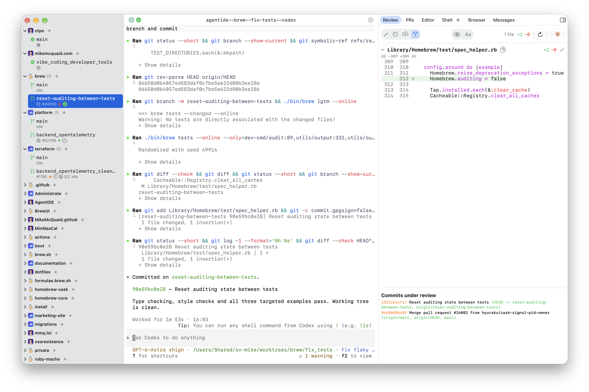

# 🪪 Sanductor

Sanductor is a native macOS workspace for maintainers to run coding agents, review their work and ship pull requests.
[sandvault](https://github.com/webcoyote/sandvault) runs all agents under a separate non-admin macOS user with a clean environment, keeping your home directory, GitHub credentials and inherited secrets out of reach even in YOLO mode.

## 💡 Motivation

I lead [Homebrew](https://brew.sh), so protecting my GitHub credentials and signing keys is part of my responsibility to its users.
I treat agent code as untrusted and run it under a separate macOS user.
My [secure agentic coding workflow](https://mikemcquaid.com/sandboxed-agent-worktrees-my-coding-and-ai-setup-in-2026/) now fits in one app, from prompt to reviewed, signed and merged pull request.
macOS enforces the sandbox; GitHub access and manual pushes use my account.
No Sanductor account, subscription or hosted relay is required.



## ✨ Features

- Runs Claude Code or Codex CLI in parallel worktrees, directly on macOS without containers or virtual machines.
- Reviews diffs with comments and a second agent, Copilot or CodeRabbit.
- Fixes reviews, failing CI and upstream merge conflicts locally, resuming feedback watching after relaunch.
- Opens pull requests with commit signing, rebasing, stack pushes, automerge and merge cleanup.
- Keeps agents running when the app closes and conversations browsable and resumable after worktree deletion.
- Starts from prompts, issues, PRs or unpublished security advisories.
- Schedules repository prompts daily, weekly or monthly while open.
- Tracks agents, PRs and blockers by repository or status, with bulk worktree actions and notifications.
- Edits code with highlighting and search alongside worktree shell tabs.
- Starts tasks and checks blockers through Shortcuts and Siri, with an [iPhone companion](#-iphone-companion).

## 🚫 Out of Scope

One developer, one Mac: no Windows, Linux, multi-user or hosted support.
Bring your own agent CLI and sandboxed non-admin user; no marketplace, bundled models, built-in updater or Mac App Store build.

## 📋 Requirements

- An Apple silicon Mac running macOS Tahoe (26) or later.
- [Homebrew](https://brew.sh), with Git, [`gh`](https://cli.github.com), [`herdr`](https://herdr.dev) and [ripgrep](https://github.com/BurntSushi/ripgrep) installed.
- [sandvault](https://github.com/webcoyote/sandvault) 1.29 or later, which creates the sandbox user and the shared workspace.
- [`gh`](https://cli.github.com) authenticated as you; it stays with your user and agents never see it.
- Claude Code or Codex CLI installed and signed in inside sandvault.
- Xcode 27.2 or later, only to build from source.

## 📦 Installation

```bash
brew install --cask sanductor
```

Update with `brew upgrade`, or unzip a signed [release](https://github.com/MikeMcQuaid/Sanductor/releases) into /Applications.

To run the current source, use `script/bootstrap` then `script/install`.

### Upgrading from AgentIDE

Mac settings, conversations and herdr sessions migrate automatically on first launch; agents can keep running.
Keep the old herdr session directories and shared `agentide/` directory, which migrated sessions and archived prompts still use.

1. Update custom app paths, shell aliases and environment variables to `Sanductor.app`, `sanductor` and `SANDUCTOR_*`, using `sanductor` or `sanductor-dev` for explicit `HERDR_SESSION` values.
2. Replace AgentIDE Dock items and Shortcuts actions, and grant any macOS permissions requested by Sanductor.
3. For the iPhone app, repeat the [connection and SSH key setup](#-iphone-companion); after connecting successfully, remove the old phone key from sandvault's authorised keys and run `sv build`.

## ⚙️ Configuration

Settings (Cmd-,) controls:

- **General**: Choose session defaults, signing and the browser.
- **Schedules**: Manage recurring repository jobs or start them now.
- **Sessions**: Inspect and stop agents and browser pages.
- **Review**: Choose reviewers, models, effort and review or fix prompts.
- **Notifications**: Choose notifications, Dock badges and sounds.
- **Fonts**: Customise fonts and sizes.
- **Editor**: Choose the external editor opened with Cmd-click.
- **Advanced**: Set paths, refresh intervals, idle sleep and logging.

Use `sanductor .` to select a worktree or `sanductor /some/file` to open a file.
To use Sanductor as your editor inside its shell panes, add this to your shell configuration:

```bash
if [ -n "${SANDUCTOR}" ]; then
  export EDITOR="$(command -v sanductor) --wait"
  export VISUAL="${EDITOR}"
fi
```

## 🛠️ Development

Use `script/build`, `script/test`, `script/style --fix` and `script/analyze` for [development](ARCHITECTURE.md#dependencies-and-toolchain).
See the [release process](ARCHITECTURE.md#releases) for publishing.

## 📱 iPhone companion

- Views and steers your Mac's agents over SSH, without a hosted relay.
- Starts tasks and manages blockers from your iPhone.

Requires iOS 26 or later; run `script/bootstrap` and `script/install` on your Mac, then choose a signing team in Xcode and build `Sanductor-iOS`.

1. Copy the public key from iPhone Settings to your Mac's clipboard, then install it for the sandbox user:

   ```bash
   mkdir -p ~/.config/codeofhonor/sandvault/authorized_keys.d
   pbpaste >~/.config/codeofhonor/sandvault/authorized_keys.d/sanductor-phone
   sv build
   ```

   This needs sandvault 1.29 or later; deleting that file and running `sv build` again revokes the key.

2. Add this to `/etc/ssh/sshd_config.d/000-sanductor.conf`, replacing `<you>` with your username and adjusting the workspace path, then enable Remote Login for `sandvault-<you>`:

   ```text
   Match User sandvault-<you>
       SetEnv SHARED_WORKSPACE=/Users/Shared/sv-<you>
   ```

3. In the iPhone app, enter your Mac's address and username; it adds `sandvault-` automatically.
   Use port `22` unless changed and select `sanductor` for the installed app or `sanductor-dev` for development.
   Choose **Connect** and verify the host key against `ssh-keygen -lf /etc/ssh/ssh_host_ed25519_key.pub` on your Mac.
   A changed key must be explicitly replaced in Settings.

## 📄 Licence and contact

[AGPL-3.0](LICENSE); personal software without support or compatibility guarantees.
[Contact Mike McQuaid](mailto:mike@mikemcquaid.com).
[Octicons](https://github.com/primer/octicons) are vendored in `App/Assets.xcassets` and licensed under the [MIT License](https://github.com/primer/octicons/blob/main/LICENSE).
